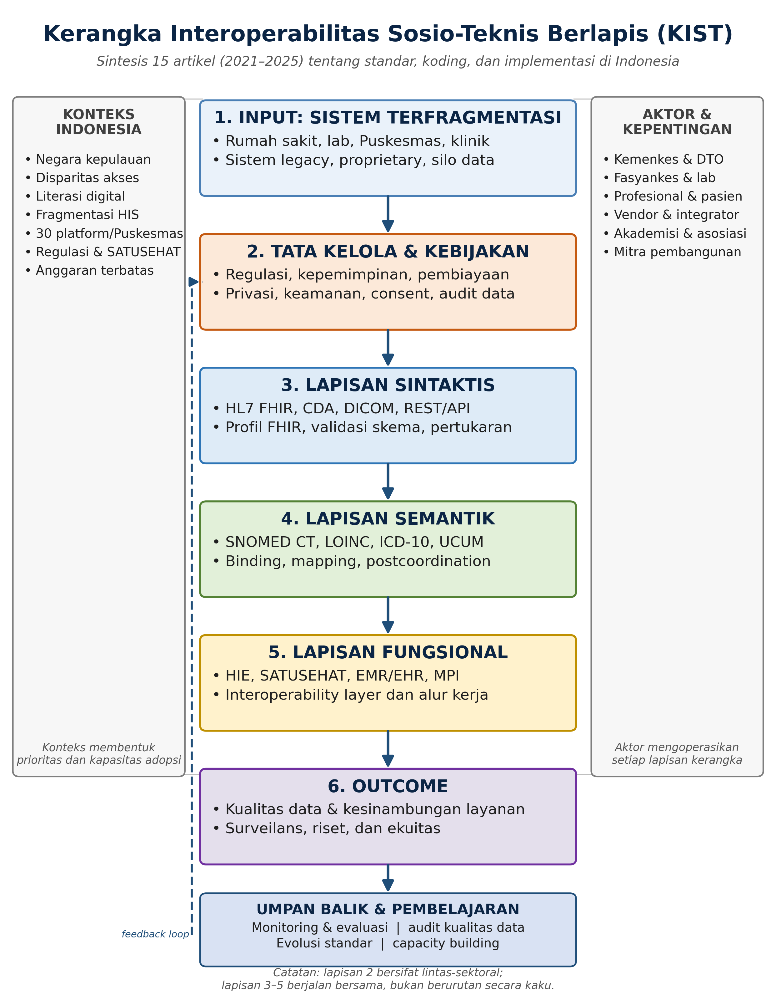

```{=openxml}
<w:p><w:r><w:br w:type="page"/></w:r></w:p>
```

## Abstrak

**Latar belakang.** Digitalisasi layanan kesehatan telah menghasilkan volume data yang besar, tetapi data tersebut sering tersimpan dalam sistem yang terfragmentasi. Perbedaan format, terminologi, identitas pasien, dan mekanisme pertukaran membuat data sulit digunakan lintas fasilitas, meskipun standar interoperabilitas sudah tersedia. Review ini mensintesis bukti tentang tantangan interoperabilitas, peran standar dan sistem koding, serta implementasi standardisasi di Indonesia.

**Tujuan.** Review ini menjawab empat pertanyaan: (1) apa tantangan utama interoperabilitas sistem informasi kesehatan; (2) bagaimana HL7 FHIR, ICD-10, SNOMED CT, LOINC, dan DICOM mendukung interoperabilitas sintaksis, semantik, dan fungsional; (3) apa tantangan dan peluang standardisasi data kesehatan di Indonesia, khususnya rekam medis elektronik (RME) dan SATUSEHAT; serta (4) gap riset dan arah masa depan apa yang dapat diidentifikasi.

**Metode.** Structured literature review terhadap 15 artikel open-access paling dominan yang dipilih dari korpus 26 artikel terbit 2020–2026, yang bersumber dari Europe PMC, OpenAlex, Crossref, dan situs penerbit, dilengkapi dokumen standar resmi sebagai sumber pendukung. Data diekstraksi ke dalam matriks sintesis dan dianalisis secara tematik lintas empat tema: tantangan interoperabilitas, standar pertukaran, sistem koding dan terminologi, serta implementasi di Indonesia.

**Hasil.** Pertama, tantangan interoperabilitas bersifat sosio-teknis: masalah teknis, semantik, organisasional, kebijakan, dan ekuitas saling terkait. Kedua, HL7 FHIR mendominasi pertukaran sintaksis dan fungsional, tetapi tidak otomatis menyelesaikan semantik; CDA, OpenEHR, dan ISO 13606 bersifat komplementer, sedangkan DICOM tetap spesifik untuk domain citra. Ketiga, SNOMED CT, LOINC, dan ICD-10 saling melengkapi, tetapi pemetaan, terminology binding, dan pemeliharaan kode menjadi bottleneck. Keempat, Indonesia menghadapi fragmentasi sistem (rata-rata 30 platform HIS per Puskesmas), kesenjangan infrastruktur, kesiapan SDM yang belum merata, dan tata kelola yang belum matang; SATUSEHAT adalah platform yang diperlukan, tetapi bukan solusi tunggal. Berdasarkan sintesis tersebut, diusulkan Kerangka Interoperabilitas Sosio-Teknis Berlapis (KIST) yang menempatkan tata kelola sebagai lapisan lintas-sektoral dan menghubungkan input, sintaksis, semantik, fungsional, outcome, serta umpan balik.

**Kontribusi.** Review ini menyediakan matriks sintesis 15 artikel, kritik terhadap asumsi bahwa standar tunggal dapat menyelesaikan interoperabilitas, kerangka konseptual yang dapat diuji, dan agenda riset yang berorientasi pada outcome, ekuitas, dan konteks Indonesia.

**Kata kunci:** interoperabilitas; HL7 FHIR; SNOMED CT; LOINC; ICD-10; DICOM; SATUSEHAT; rekam medis elektronik

# 1. Pendahuluan

Digitalisasi layanan kesehatan telah mengubah cara data pasien dihasilkan, disimpan, dan dipertukarkan. Rumah sakit, laboratorium, puskesmas, klinik swasta, dan program kesehatan masyarakat menghasilkan data dalam volume besar, tetapi data tersebut sering tersimpan dalam sistem yang dibangun untuk kebutuhan masing-masing unit. Akibatnya, informasi yang seharusnya menjadi dasar kesinambungan layanan justru terfragmentasi ke dalam silo aplikasi, basis data, dan format yang berbeda [@A01; @A05]. Fragmentasi ini bukan sekadar masalah teknis. Ia berdampak pada kualitas layanan, keselamatan pasien, efisiensi biaya, dan kemampuan sistem kesehatan untuk merespons kebutuhan populasi secara tepat waktu [@A01; @A05].

Interoperabilitas didefinisikan sebagai kemampuan dua atau lebih sistem untuk bertukar dan menggunakan informasi [@A01]. Dalam literatur kesehatan, kemampuan ini biasanya dibagi menjadi beberapa level. Level fondasi menyangkut konektivitas dan keamanan pertukaran data; level sintaksis menyangkut format, struktur pesan, dan aturan pengodean data; level semantik menyangkut makna konsep dan terminologi yang digunakan; sedangkan level fungsional dan organisasional menyangkut kemampuan sistem dan organisasi untuk menggunakan data yang dipertukarkan dalam alur kerja nyata [@A01; @C01]. Pembagian ini penting karena menunjukkan bahwa memiliki format pesan yang sama belum berarti dua sistem memahami data dengan cara yang sama. Standar sintaksis dapat memastikan bahwa pesan “sampai”, tetapi standar semantik yang menentukan apakah pesan tersebut “dimengerti”.

Standar dan sistem koding telah dikembangkan untuk menjawab tantangan tersebut. HL7 FHIR menyediakan resource, profil, dan REST API untuk pertukaran data granular [@STD_FHIR; @B01]. HL7 CDA menyediakan format dokumen klinis terstruktur, sementara DICOM menyediakan format citra, metadata, dan layanan jaringan untuk pencitraan medis [@STD_DICOM; @B05]. Pada lapisan semantik, SNOMED CT menyediakan terminologi klinis yang komprehensif, LOINC menyediakan identifikasi tes laboratorium dan observasi, dan ICD-10 menyediakan klasifikasi penyakit untuk morbiditas, mortalitas, dan tujuan administratif [@STD_SNOMED; @STD_LOINC; @STD_ICD]. Kombinasi standar-standar ini secara teoritis mampu menjawab kebutuhan interoperabilitas dari level sintaksis hingga semantik.

Namun, ketersediaan standar tidak berbanding lurus dengan terwujudnya interoperabilitas. Kajian kebijakan di lima negara berpendapatan tinggi menunjukkan bahwa adopsi HIE menghadapi tantangan tata kelola, privasi, biaya, insentif kompetisi, dan alur kerja klinis, bahkan ketika standar teknis sudah mapan [@A02]. Studi kualitatif terhadap 24 stakeholder di Ohio menunjukkan bahwa interoperabilitas secara teknis mungkin dilakukan, tetapi tetap sulit karena perbedaan kapabilitas antarorganisasi, keterbatasan vendor, dan ketidakselarasan insentif pembayaran [@A05]. Dengan kata lain, terdapat “paradoks standar”: semakin banyak standar tersedia, semakin jelas bahwa interoperabilitas bukan hanya persoalan memilih standar yang benar, melainkan persoalan membangun tata kelola, kapasitas, dan alur kerja yang memungkinkan standar tersebut bekerja.

Paradoks ini sangat relevan untuk Indonesia. Indonesia memiliki sekitar 10.260 Puskesmas yang tersebar di 34 provinsi, dan survei terhadap 2.606 Puskesmas menemukan rata-rata 30 platform HIS yang digunakan di setiap Puskesmas [@D08]. Sebanyak 9,45% Puskesmas tidak memiliki akses internet, dan hanya 28,9% yang memiliki koneksi internet yang memadai [@D08]. Pemerintah telah menetapkan kewajiban RME melalui Peraturan Menteri Kesehatan Nomor 24 Tahun 2022 [@REG_RME] dan meluncurkan SATUSEHAT sebagai platform pertukaran data berbasis FHIR [@PLAT_SATUSEHAT; @D01]. Meskipun demikian, pemantauan yang dikutip dalam review kebijakan menunjukkan bahwa baru sekitar 61,42% fasilitas kesehatan yang mengadopsi RME, dengan hambatan infrastruktur, panduan implementasi, dan pelatihan SDM [@D07]. Studi di 23 Puskesmas Kota Padang menemukan bahwa hanya 47,8% tenaga kesehatan siap menerapkan RME [@D06]. Di sisi lain, analisis percakapan developer SATUSEHAT menunjukkan bahwa pain point terbesar justru muncul pada implementasi server FHIR, pemetaan terminologi, dan pemilihan profil [@D01].

Kesenjangan antara ketersediaan standar dan realitas implementasi itulah yang menjadi fokus review ini. Literatur sebelumnya cenderung terfokus pada satu standar atau satu domain: review tentang FHIR [@B01], review tentang SNOMED CT [@C03], review tentang LOINC [@C05], atau review tentang DICOM [@B05]. Review yang lebih luas tentang interoperabilitas HIS [@A01] dan interoperabilitas semantik [@C01] memang ada, tetapi belum menghubungkan secara eksplisit antara standar, level interoperabilitas, dan konteks implementasi Indonesia. Selain itu, banyak studi Indonesia yang bersifat deskriptif, cross-sectional, atau pilot, sehingga belum memberikan gambaran sintesis tentang apa yang benar-benar bekerja, untuk siapa, dan dalam kondisi apa [@D01; @D06; @D07; @D08]. Review ini mengisi celah tersebut dengan menyusun matriks sintesis lintas tema, mengkritisi asumsi-asumsi yang mendasari literatur, dan merumuskan kerangka konseptual yang dapat diuji.

Berdasarkan latar belakang tersebut, review ini menjawab empat pertanyaan penelitian berikut.

**RQ1.** Apa tantangan utama interoperabilitas dalam sistem informasi kesehatan, khususnya dalam pertukaran data lintas rumah sakit, laboratorium, dan fasilitas layanan primer?

**RQ2.** Bagaimana standar dan sistem koding kesehatan (HL7 FHIR, ICD-10, SNOMED CT, LOINC, dan DICOM) mendukung interoperabilitas sintaksis, semantik, dan fungsional?

**RQ3.** Apa tantangan dan peluang implementasi standardisasi data kesehatan di Indonesia, khususnya dalam kaitannya dengan rekam medis elektronik dan SATUSEHAT?

**RQ4.** Gap riset dan arah masa depan apa yang dapat diidentifikasi untuk meningkatkan interoperabilitas, kualitas data, dan pertukaran informasi klinis?

Kontribusi review ini ada empat. Pertama, review menyusun matriks sintesis 15 artikel yang tidak hanya memuat judul dan penulis, tetapi juga standar yang dibahas, level interoperabilitas, temuan utama, dan limitasi/gap. Kedua, review melakukan sintesis kritis lintas tema untuk menunjukkan konvergensi, perbedaan, dan ketegangan dalam literatur. Ketiga, review mengusulkan Kerangka Interoperabilitas Sosio-Teknis Berlapis (KIST) yang menghubungkan tata kelola, sintaksis, semantik, fungsional, outcome, dan umpan balik. Keempat, review merumuskan agenda riset yang relevan untuk Indonesia, termasuk kebutuhan evaluasi outcome, ekuitas, dan penguatan tata kelola data.

Sisa paper disusun sebagai berikut. Bagian 2 menjelaskan metodologi review, termasuk sumber, string pencarian, kriteria inklusi/eksklusi, dan proses seleksi. Bagian 3 menyajikan hasil literature review per tema dan matriks sintesis. Bagian 4 menyajikan sintesis kritis dan diskusi, termasuk perbandingan standar dan implikasi untuk Indonesia. Bagian 5 mengidentifikasi research gap dan arah masa depan. Bagian 6 menjelaskan kerangka konseptual yang diusulkan. Bagian 7 menyimpulkan jawaban atas RQ dan kontribusi review.

# 2. Metodologi Review

## 2.1 Desain review

Review ini menggunakan pendekatan *structured literature review* dengan sintesis tematik. Pendekatan ini dipilih karena literatur tentang interoperabilitas dan standardisasi sangat heterogen: mencakup systematic review, scoping review, studi kasus, studi kualitatif, studi pengembangan teknis, uji kesiapan, dan analisis kebijakan. Heterogenitas tersebut tidak memungkinkan meta-analisis kuantitatif, tetapi memungkinkan sintesis naratif yang terstruktur untuk mengidentifikasi pola, perbedaan, dan gap [@A01; @C01].

Review ini mengadopsi elemen alur PRISMA untuk transparansi proses identifikasi, skrining, dan seleksi, tetapi tidak mengklaim sebagai systematic review penuh. Alasannya, proses seleksi dilakukan oleh satu reviewer, tidak ada dual screening independen, dan tidak ada protokol yang diregistrasi sebelumnya. Keterbatasan ini diakui secara eksplisit di Bagian 2.7 dan menjadi bagian dari refleksi metodologis.

## 2.2 Sumber informasi dan tanggal pencarian

Pencarian dilakukan pada 5 November 2026 melalui sumber berikut:

- **Europe PMC**, yang mencakup PubMed/PMC dan menyediakan full text open-access.
- **OpenAlex**, untuk verifikasi metadata, DOI, dan lokasi open-access.
- **Crossref**, untuk verifikasi metadata sitasi (penulis, tahun, volume, halaman).
- **Situs penerbit**: BMC, JMIR, MDPI, Frontiers, Springer, PLOS, Universitas Gadjah Mada, dan BIO Web of Conferences.

Database yang disebut dalam panduan tugas (IEEE Xplore, Scopus, ScienceDirect, ACM) tidak diakses secara sistematis karena keterbatasan akses institusional. Artikel dari penerbit tersebut dapat ditambahkan pada review lanjutan. Ketiadaan database tersebut merupakan keterbatasan cakupan, bukan klaim bahwa literatur yang ada telah mencakup seluruh bukti yang relevan.

## 2.3 String pencarian

String pencarian disusun per tema dan dijalankan dengan sintaks Europe PMC. Beberapa query disederhanakan karena sintaks Europe PMC sensitif terhadap tanda kutip dan tanda hubung. Tabel berikut merangkum string utama yang digunakan.

| Tema | String pencarian utama |
|---|---|
| A. Tantangan interoperabilitas | `(TITLE_ABS:"health information exchange" AND TITLE_ABS:"interoperability") AND OPEN_ACCESS:Y AND PUB_YEAR:[2020 TO 2026]`; `(TITLE_ABS:"interoperability challenges" AND TITLE_ABS:"healthcare") AND OPEN_ACCESS:Y AND PUB_YEAR:[2020 TO 2026]`; `(TITLE_ABS:"health information systems" AND TITLE_ABS:"integration") AND OPEN_ACCESS:Y AND PUB_YEAR:[2020 TO 2026]` |
| B. Standar pertukaran | `TITLE_ABS:"HL7 FHIR" AND OPEN_ACCESS:Y AND PUB_YEAR:[2020 TO 2026]`; `(TITLE_ABS:"FHIR" AND TITLE_ABS:"interoperability") AND OPEN_ACCESS:Y AND PUB_YEAR:[2020 TO 2026]`; `TITLE_ABS:"HL7 CDA" AND OPEN_ACCESS:Y AND PUB_YEAR:[2020 TO 2026]`; `(TITLE_ABS:"DICOM" AND TITLE_ABS:"interoperability") AND OPEN_ACCESS:Y AND PUB_YEAR:[2020 TO 2026]` |
| C. Koding dan terminologi | `(TITLE_ABS:"SNOMED CT" AND TITLE_ABS:"interoperability") AND OPEN_ACCESS:Y AND PUB_YEAR:[2020 TO 2026]`; `TITLE_ABS:LOINC AND OPEN_ACCESS:Y AND PUB_YEAR:[2020 TO 2026]`; `(TITLE_ABS:"semantic interoperability" AND TITLE_ABS:"health") AND OPEN_ACCESS:Y AND PUB_YEAR:[2020 TO 2026]`; `TITLE_ABS:ICD AND TITLE_ABS:coding AND OPEN_ACCESS:Y AND PUB_YEAR:[2020 TO 2026]` |
| D. Indonesia dan SATUSEHAT | `SATUSEHAT`; `(TITLE_ABS:"Indonesia" AND (TITLE_ABS:"interoperability" OR TITLE_ABS:"health information exchange")) AND OPEN_ACCESS:Y AND PUB_YEAR:[2020 TO 2026]`; `(TITLE_ABS:"Indonesia" AND (TITLE_ABS:"electronic medical record" OR TITLE_ABS:"electronic health record")) AND OPEN_ACCESS:Y AND PUB_YEAR:[2020 TO 2026]`; `(TITLE_ABS:"Indonesia" AND TITLE_ABS:"health information system") AND OPEN_ACCESS:Y AND PUB_YEAR:[2020 TO 2026]` |

: Tabel 1. String pencarian utama per tema

## 2.4 Kriteria inklusi dan eksklusi

**Kriteria inklusi:**

1. Artikel jurnal atau conference paper yang peer-reviewed.
2. Dipublikasikan pada 2020–2026, dengan prioritas pada literatur terbaru.
3. Berbahasa Inggris atau Indonesia.
4. Tersedia full text open-access.
5. Membahas minimal satu dari topik berikut: interoperabilitas HIS/EHR, HIE, HL7 FHIR/CDA, DICOM, SNOMED CT, LOINC, ICD-10, SATUSEHAT, atau implementasi standardisasi di Indonesia.
6. Relevan dengan RQ1–RQ4.

**Kriteria eksklusi:**

1. Editorial, komentar, koreksi, erratum, dan preprint.
2. Artikel tanpa full text yang dapat diakses.
3. Artikel non-kesehatan yang hanya menggunakan istilah “interoperability” secara umum.
4. Duplikasi (versi preprint dan versi jurnal dianggap satu).
5. Dokumen standar resmi (HL7, WHO, Kemenkes) yang digunakan sebagai sumber pendukung, bukan sebagai artikel yang dihitung dalam kuota 15.

## 2.5 Proses seleksi

Proses seleksi dilakukan dalam lima tahap. Angka pada tahap awal bersifat perkiraan karena pencarian dijalankan secara iteratif dan beberapa query menghasilkan duplikasi.

1. **Identifikasi:** sekitar 150 kandidat dari Europe PMC, OpenAlex, dan pencarian manual di situs penerbit.
2. **Skrining judul dan abstrak:** sekitar 45 kandidat yang relevan dengan tema A–D.
3. **Eligibilitas full text:** pemeriksaan ketersediaan full text, kesesuaian topik, dan kualitas metodologis.
4. **Eligible:** 26 artikel (A = 6; B = 5; C = 7; D = 8).
5. **Included dalam sintesis:** 15 artikel paling dominan (A = 4; B = 3; C = 4; D = 4).

Seleksi 15 artikel dilakukan pada tahap sintesis, bukan pada tahap kelayakan. Artikel dipilih berdasarkan empat pertimbangan: (1) kontribusi konseptual atau empiris terhadap RQ1–RQ4; (2) keterwakilan standar dan level interoperabilitas yang dibahas; (3) kekuatan desain studi dan kejelasan pelaporan; serta (4) relevansi langsung dengan konteks Indonesia atau negara berpendapatan menengah. Kesebelas artikel lainnya tetap tersedia di folder kerja, tetapi tidak disintesis dalam review ini agar analisis lebih terfokus dan setiap klaim dapat ditelusuri ke bukti yang paling kuat.

Dari 26 artikel yang eligible, dua artikel berupa *reading copy* yang dihasilkan dari full text XML Europe PMC karena PDF penerbit diblokir oleh Cloudflare, yaitu C01 dan D01. Isi kedua artikel diverifikasi terhadap metadata DOI dan judul, tetapi tata letaknya bukan layout penerbit. Keterbatasan ini dicatat agar pembaca tidak menganggapnya sebagai PDF resmi penerbit.

## 2.6 Ekstraksi data dan penilaian kualitas

Data yang diekstraksi mencakup: identitas artikel (penulis, tahun, jurnal, DOI), desain studi, standar yang dibahas, level interoperabilitas, temuan utama, limitasi/gap, dan relevansi untuk Indonesia. Data dimasukkan ke dalam matriks sintesis 15 baris (Tabel 3). Kolom “temuan utama” dan “limitasi/gap” diisi berdasarkan abstrak, hasil, diskusi, dan bagian limitasi artikel, bukan hanya berdasarkan judul.

Penilaian kualitas dilakukan secara naratif dengan lima kriteria: (1) kejelasan desain dan pertanyaan penelitian; (2) kesesuaian antara data dan metode; (3) transparansi analisis; (4) pelaporan limitasi; dan (5) relevansi terhadap RQ. Tidak digunakan skor kuantitatif karena heterogenitas desain dan tidak adanya instrumen penilaian kualitas yang disepakati untuk seluruh jenis studi. Penilaian ini digunakan untuk memberi bobot pada interpretasi, bukan untuk mengeliminasi artikel.

## 2.7 Analisis dan sintesis

Analisis dilakukan dalam tiga langkah. Pertama, artikel dikelompokkan ke dalam empat tema yang ditetapkan oleh panduan tugas (A–D). Kedua, dilakukan *constant comparison* lintas artikel untuk mengidentifikasi pola, perbedaan, dan ketegangan. Ketiga, kategori sintesis dipertajam melalui pertanyaan: standar apa yang menyelesaikan masalah apa, pada level apa, dan dalam kondisi apa. Dari proses ini, muncul lima kategori lintas tema: (1) tantangan sosio-teknis; (2) standar sebagai prasyarat tetapi bukan jaminan; (3) tata kelola dan kebijakan; (4) semantik sebagai bottleneck; dan (5) konteks dan kapasitas lokal. Kategori-kategori ini menjadi dasar Kerangka Interoperabilitas Sosio-Teknis Berlapis (KIST) di Bagian 6.

## 2.8 Keterbatasan metodologis

Review ini memiliki beberapa keterbatasan. Pertama, seleksi dan ekstraksi dilakukan oleh satu reviewer sehingga berpotensi bias seleksi dan interpretasi. Kedua, pencarian tidak mencakup IEEE Xplore, Scopus, ScienceDirect, dan ACM secara sistematis. Ketiga, literatur yang dimasukkan hanya berbahasa Inggris dan Indonesia, sehingga bukti dari bahasa lain tidak tercakup. Keempat, tidak dilakukan snowballing sistematis (backward/forward citation), meskipun beberapa artikel kunci saling merujuk. Kelima, tidak ada meta-analisis karena heterogenitas desain dan outcome. Keenam, dua PDF merupakan reading copy, bukan PDF penerbit. Ketujuh, literatur tentang standar terus berkembang; temuan review ini mencerminkan kondisi hingga November 2026 dan perlu diperbarui seiring rilis standar baru.

# 3. Hasil Literature Review

## 3.1 Gambaran umum artikel

Dari 15 artikel yang dianalisis, sebaran tema adalah sebagai berikut: tema A (tantangan interoperabilitas) 4 artikel, tema B (standar pertukaran) 3 artikel, tema C (koding dan terminologi) 4 artikel, dan tema D (implementasi dan tantangan di Indonesia) 4 artikel. Sebaran tahun adalah 2021: 5 artikel; 2022: 1 artikel; 2023: 5 artikel; 2024: 2 artikel; dan 2025: 2 artikel. Seluruh artikel (100%) terbit pada 2021–2025 dan berada dalam rentang pencarian 2020–2026.

Dari segi desain, literatur didominasi oleh review (systematic review, scoping review, narrative review, state-of-the-art review) dan studi pengembangan/pilot. Terdapat pula studi kualitatif, studi cross-sectional, studi kasus, analisis kebijakan, studi pemetaan, dan analisis retrospektif. Dominasi review dan pilot menunjukkan bahwa bidang ini masih dalam fase konsolidasi konsep dan pengujian awal, belum pada fase evaluasi skala besar dengan outcome klinis dan ekonomi yang matang.

| Tema | Jumlah | ID | Fokus utama | Jenis studi dominan |
|---|---:|---|---|---|
| A. Healthcare interoperability | 4 | A01, A02, A04, A05 | Tantangan integrasi HIS/EHR, HIE, kebijakan, dan perspektif stakeholder | Systematic review, policy review, case study, qualitative study |
| B. Healthcare standards | 3 | B01, B03, B05 | HL7 FHIR, OpenEHR/ISO 13606, DICOM | Systematic review, viewpoint, perspective |
| C. Coding & terminology systems | 4 | C01, C03, C05, C08 | SNOMED CT, LOINC, ICD-10, semantic interoperability | Systematic/scoping review, opinion/review, retrospective analysis |
| D. Implementation & challenges (Indonesia) | 4 | D01, D06, D07, D08 | SATUSEHAT, RME, kesiapan Puskesmas, HIS | Content analysis, mixed-method, policy review, cross-sectional survey |
| **Total** | **15** | | | |

: Tabel 2. Sebaran artikel berdasarkan tema, fokus, dan jenis studi

Catatan: ID artikel dipertahankan dari korpus awal agar konsisten dengan file kerja dan matriks sintesis. ID yang tidak tercantum tidak termasuk dalam 15 artikel paling dominan yang disintesis, sehingga tidak digunakan sebagai dasar klaim dalam review ini.

## 3.2 Tema A: Tantangan interoperabilitas sistem informasi kesehatan

### 3.2.1 Keragaman kebutuhan dan level interoperabilitas

Review sistematis oleh Torab-Miandoab et al. menganalisis 36 artikel dari enam database hingga Juli 2022 untuk mengidentifikasi kebutuhan interoperabilitas sistem informasi kesehatan yang heterogen [@A01]. Temuan utamanya adalah bahwa kebutuhan tersebut tidak tunggal. HL7 FHIR, CDA, HIPAA, SNOMED CT, SOA, RIM, XML, API, Java, dan SQL muncul sebagai kebutuhan yang saling terkait, mencerminkan bahwa interoperabilitas mencakup standar pertukaran, arsitektur perangkat lunak, keamanan, dan terminologi. Review tersebut menyimpulkan bahwa interaksi semantik merupakan pilihan terbaik untuk menjamin pertukaran data, karena sistem dapat mengenali dan memproses informasi yang serupa secara homogen [@A01].

Temuan ini penting karena dua alasan. Pertama, ia menunjukkan bahwa interoperabilitas tidak dapat direduksi menjadi satu standar. Kedua, ia menempatkan semantik sebagai inti, bukan sebagai lapisan tambahan. Namun, review tersebut berfokus pada kebutuhan dan bukan pada evaluasi empiris sistem yang diimplementasikan. Oleh karena itu, temuan A01 lebih tepat dibaca sebagai peta konseptual kebutuhan, bukan sebagai bukti efektivitas.

### 3.2.2 Kebijakan dan tata kelola HIE

Kajian kebijakan oleh Holmgren et al. membandingkan lima negara—Amerika Serikat, Inggris, Jerman, Israel, dan Portugal—dan menemukan bahwa tidak ada satu model HIE yang berlaku universal [@A02]. Meskipun demikian, ada tema umum: keputusan terpusat perlu dikombinasikan dengan inovasi lokal; adopsi HIE menghadapi tantangan teknis, tata kelola, privasi dan keamanan, biaya, insentif kompetisi, serta pertanyaan alur kerja tentang bagaimana menyajikan informasi yang relevan kepada klinisi. Studi ini juga menekankan bahwa manfaat HIE secara teoretis jelas, tetapi mendemonstrasikan nilainya pada skala besar lebih sulit [@A02].

Temuan A02 penting karena menunjukkan bahwa tata kelola bukan “faktor pendukung” yang bisa ditambahkan belakangan, melainkan kondisi yang menentukan apakah standar dapat dioperasikan. Model HIE negara berpendapatan tinggi juga tidak dapat dianggap sebagai template universal; kasus Tanzania di bagian berikutnya menunjukkan bahwa kepemilikan pemerintah dan pendekatan bertahap dapat menjadi alternatif yang lebih sesuai dengan kapasitas lokal.

### 3.2.3 Implementasi di negara berpendapatan rendah-menengah: kasus Tanzania

Studi kasus Tanzania oleh Nsaghurwe et al. memberikan contoh implementasi yang lebih konkret [@A04]. Pemerintah Tanzania dan mitra melaksanakan prosedur lima langkah berbasis kerangka “Mind the GAPS” (governance, architecture, program management, standards) dari 2014 hingga 2019. Mereka mengembangkan empat use case—pertukaran data antar rumah sakit, antara layanan dan rantai pasok, lintas sistem data digital, dan dalam sistem pelaporan rantai pasok—serta membangun lapisan interoperabilitas (interoperability layer) sebagai middleware. Hasilnya, pertukaran data berhasil menghubungkan 15 sistem informasi yang terpisah, meningkatkan ketersediaan data, dan menghemat waktu. Pemerintah Tanzania kemudian mengadopsi HIE ke dalam strategi kesehatan nasional dan mengoperasikan sistem tersebut [@A04].

Studi ini penting karena menunjukkan bahwa interoperabilitas dapat dicapai secara bertahap dengan tata kelola yang jelas dan kepemilikan pemerintah. Namun, studi ini juga memiliki keterbatasan: ia merupakan studi kasus satu negara pada fase pertama, tanpa evaluasi outcome kuantitatif atau analisis biaya. Pertanyaan tentang keberlanjutan, skalabilitas, dan ketergantungan pada dukungan donor belum terjawab [@A04]. Karena itu, Tanzania lebih tepat diposisikan sebagai bukti kelayakan (proof of feasibility) daripada bukti efektivitas jangka panjang.

### 3.2.4 Perspektif stakeholder dan dimensi organisasi

Studi kualitatif oleh Walker et al. terhadap 24 stakeholder di Ohio menemukan bahwa tantangan interoperabilitas terbagi ke dalam tiga domain: teknologis, organisasional, dan lingkungan/kebijakan [@A05]. Pada domain teknologis, masalahnya mencakup kesulitan implementasi, ketidaksesuaian kapabilitas antarstakeholder, dan peluang memanfaatkan teknologi baru serta mengintegrasikan data social determinants of health. Pada domain organisasional, faktor yang berperan mencakup fasilitator interoperabilitas dan keselarasan strategi dengan program pembayaran berbasis nilai. Pada domain lingkungan, kebijakan dan regulasi menjadi penentu [@A05].

Temuan A05 memperkuat argumen bahwa interoperabilitas adalah masalah sosio-teknis. Bahkan ketika dua sistem secara teknis dapat bertukar data, pertukaran tersebut mungkin tidak terjadi karena organisasi tidak memiliki insentif, kapasitas, atau alur kerja yang mendukung. Studi ini juga menunjukkan bahwa rumah sakit, primary care providers, behavioral health providers, dan regional HIE networks memiliki kapabilitas dan kepentingan yang berbeda. Kebijakan yang mengabaikan perbedaan ini berisiko menghasilkan solusi yang tidak digunakan [@A05].

### 3.2.5 Sintesis tema A

Sintesis tema A menunjukkan bahwa tantangan interoperabilitas dapat dikelompokkan menjadi lima lapis: (1) teknis (format, API, arsitektur, server); (2) semantik (terminologi, koding, makna); (3) organisasional (alur kerja, kepemimpinan, insentif, kapasitas); (4) kebijakan dan tata kelola (regulasi, privasi, kepemilikan data, pembiayaan); dan (5) ekuitas dan konteks (infrastruktur, geografi, literasi digital). Kelima lapis ini saling bergantung. Intervensi yang hanya menyentuh satu lapis—misalnya menyediakan API tanpa memperbaiki kualitas data atau tanpa mengubah alur kerja—cenderung gagal [@A01; @A05; @D08].

Tema A juga menunjukkan bahwa literatur tentang interoperabilitas bergerak dari pertanyaan “standar apa yang harus digunakan?” menuju pertanyaan “bagaimana standar digunakan dalam konteks organisasi dan kebijakan tertentu?”. Pertanyaan kedua lebih sulit, tetapi lebih menentukan keberhasilan. Inilah yang menjadi dasar kritik terhadap pendekatan technology-first dalam banyak proyek eHealth.

## 3.3 Tema B: Standar pertukaran dan arsitektur

### 3.3.1 HL7 FHIR: kapabilitas, adopsi, dan kematangan

Review sistematis oleh Ayaz et al. menganalisis 80 dari 8.181 artikel yang terbit antara Januari 2012 dan Desember 2019 [@B01]. Review ini mengidentifikasi resource FHIR, REST API, model implementasi, resource yang digunakan, pendekatan migrasi data, dan tantangan implementasi. FHIR memungkinkan akses data pada tingkat granular melalui resource seperti Patient, Observation, Practitioner, Device, dan Condition, serta mendukung pertukaran data dalam format JSON dan XML. Tantangan yang diidentifikasi mencakup kematangan standar yang masih dalam fase awal, keengganan penyedia layanan untuk berbagi data, dan kompleksitas implementasi [@B01].

Temuan B01 menunjukkan bahwa FHIR adalah standar yang paling dinamis dan paling banyak diadopsi untuk pertukaran data, tetapi adopsinya belum merata dan belum matang. FHIR menyediakan struktur dan mekanisme pertukaran, tetapi makna data tetap bergantung pada terminologi, profil, dan kesepakatan implementasi. Oleh karena itu, FHIR tidak dengan sendirinya menyelesaikan masalah semantik [@B01].

### 3.3.2 CDA, OpenEHR, dan ISO 13606: komplementaritas, bukan kompetisi

Viewpoint oleh Pedrera-Jiménez et al. menawarkan kerangka yang berguna untuk memahami hubungan antara standar EHR [@B03]. Penulis berargumen bahwa OpenEHR, ISO 13606, dan HL7 FHIR memiliki kapabilitas yang berbeda dalam hal pemodelan, fleksibilitas, dan sumber daya implementasi. OpenEHR unggul untuk pemodelan klinis dan persistensi data; ISO 13606 unggul untuk pertukaran semantik yang kaya dan kompleks; FHIR unggul untuk pertukaran yang ringan, berbasis API, dan terstandar. Masalahnya, standar-standar ini sering diterapkan untuk tujuan yang tidak sesuai dengan desain aslinya. Oleh karena itu, penulis merekomendasikan pendekatan agnostik: pilih standar berdasarkan kebutuhan spesifik, dan kombinasikan secara fungsional dan teknis [@B03].

B03 menunjukkan bahwa “perang standar” antara FHIR, CDA, OpenEHR, dan ISO 13606 sebagian besar adalah salah frame. Standar-standar tersebut tidak saling menggantikan; mereka menempati niche yang berbeda dalam arsitektur data kesehatan. Tantangan sebenarnya adalah kemampuan organisasi untuk memilih, menggabungkan, dan memelihara standar tersebut sesuai kebutuhan. Ini adalah pesan yang sangat relevan untuk Indonesia, yang perlu membangun arsitektur interoperabilitas yang tidak bergantung pada satu vendor atau satu standar tunggal [@B03; @A02; @A05].

### 3.3.3 DICOM: standar citra dan tantangan domain spesifik

Perspective oleh Caffery et al. menjelaskan peran DICOM dalam pencitraan medis dan AI untuk penyakit kulit [@B05]. DICOM adalah standar internasional untuk pencitraan medis yang mendefinisikan format file citra, model metadata, dan layanan jaringan untuk penyimpanan, transmisi, query, dan retrieval objek. Metadata DICOM diorganisir dalam Information Object Definition (IOD), yang terdiri dari modul-modul berisi atribut pasien, studi, peralatan, dan citra. DICOM juga menyediakan mekanisme untuk objek turunan (secondary images, visual explainability maps, output algoritma AI), de-identifikasi, dan kurasi dataset multi-institusi [@B05].

Namun, adopsi DICOM di dermatologi masih terbatas. Caffery et al. mencatat bahwa DICOM sudah ubiquitious di radiologi, kardiologi, dan radioterapi, tetapi belum demikian di dermatologi. Ada upaya untuk mengembangkan extension DICOM khusus dermatologi, dan DICOM memiliki working group yang mengembangkan mekanisme untuk mendukung alur kerja AI dan menyandikan artefak AI. Meskipun demikian, hambatan teknis, etik, regulasi, medikolegal, dan tenaga kerja tetap ada [@B05]. Temuan ini menunjukkan bahwa standar domain-spesifik seperti DICOM sangat kuat di domain asalnya, tetapi memerlukan ekosistem pendukung—vendor, ahli, regulasi, dan alur kerja—untuk diadopsi secara luas.

### 3.3.4 Sintesis tema B

Sintesis tema B menunjukkan tiga hal. Pertama, FHIR adalah standar pertukaran yang paling menonjol, tetapi bukan standar tunggal yang dapat menyelesaikan semua masalah. FHIR menyediakan struktur dan API, tetapi makna data tetap memerlukan terminologi dan profil yang disepakati [@B01]. Kedua, CDA, OpenEHR, dan ISO 13606 bersifat komplementer. CDA masih relevan untuk dokumen legacy dan transisi; OpenEHR dan ISO 13606 relevan untuk pemodelan dan pertukaran semantik yang kaya; FHIR relevan untuk pertukaran modern berbasis API [@B03]. Ketiga, DICOM menunjukkan bahwa standar domain-spesifik memiliki kekuatan dan keterbatasan yang berbeda dari standar pertukaran umum. DICOM sangat matang untuk citra, tetapi adopsi di domain baru dan integrasi dengan AI memerlukan pengembangan lebih lanjut [@B05].

Implikasi untuk arsitektur interoperabilitas adalah perlunya “stack” standar, bukan “silver bullet”. Stack tersebut mencakup standar sintaksis (FHIR, CDA, DICOM), standar semantik (SNOMED CT, LOINC, ICD-10), standar arsitektural (OpenEHR, ISO 13606), dan standar keamanan (misalnya OAuth 2.0, SMART on FHIR). Pemilihan stack harus didasarkan pada kebutuhan use case, kematangan implementasi, dan kapasitas organisasi.

## 3.4 Tema C: Sistem koding dan terminologi

### 3.4.1 Lanskap interoperabilitas semantik

Review sistematis oleh de Mello et al. menganalisis literatur dari tujuh database antara 2010 dan September 2020 untuk memahami interoperabilitas semantik dalam rekam medis elektronik [@C01]. Review ini menghasilkan taksonomi yang mencakup skenario, teknologi, dan alat yang digunakan untuk mengatasi masalah interoperabilitas, serta pendekatan untuk menangani data legacy dan heterogen. Standar yang dibahas mencakup HL7, SNOMED CT, LOINC, dan openEHR. Temuan pentingnya adalah bahwa sebagian besar solusi masih berfokus pada tingkat konseptual atau prototipe, dan bukti dari implementasi dunia nyata masih terbatas [@C01].

C01 memberikan peta yang berguna, tetapi juga menunjukkan bahwa interoperabilitas semantik adalah masalah yang belum terselesaikan. Tidak ada satu terminologi yang cukup untuk semua kebutuhan; tidak ada satu metode pemetaan yang berlaku untuk semua konteks; dan tidak ada satu arsitektur yang dapat menampung semua variasi data klinis. Ini adalah argumen untuk pendekatan pluralistik yang menggabungkan beberapa standar dan tata kelola yang kuat.

### 3.4.2 Terminology binding dan penggunaan SNOMED CT dalam sistem

Review oleh Rossander et al. menganalisis 55 dari 616 makalah (2004–2020) tentang terminology binding SNOMED CT [@C03]. Terminology binding adalah proses menghubungkan elemen terminologi dengan elemen information model. Review ini menemukan bahwa masalah terminology binding berkaitan dengan materi input, SNOMED CT itu sendiri, information model, keterbatasan alat, dan kompetensi. Banyak masalah dapat diselesaikan melalui kerja sama yang lebih baik antara ahli domain dan informatician, serta pengetahuan SNOMED CT yang lebih baik. Tooling belum diteliti secara mendalam dan berpotensi menjadi cara untuk memfasilitasi terminology binding [@C03].

C03 menunjukkan bahwa terminology binding adalah pekerjaan sosio-teknis yang membutuhkan keahlian, information model yang jelas, alat yang memadai, dan kolaborasi antara ahli domain dan informatician. Temuan ini penting karena menunjukkan bahwa kualitas semantik tidak ditentukan oleh kelengkapan terminologi saja, tetapi oleh kemampuan organisasi menghubungkan terminologi dengan information model dan alur kerja [@C03]. Rekomendasi tersebut belum diuji secara empiris, sehingga bukti tentang efektivitas tooling dan skalabilitas terminology binding masih terbatas [@C03].

### 3.4.3 LOINC untuk laboratorium

Opinion/review oleh Bietenbeck dan Streichert menjelaskan mengapa laboratorium perlu bertransformasi dalam sistem kesehatan yang terhubung [@C05]. Laporan laboratorium harus machine-readable dan interpretable; terminologi seperti LOINC, NPU, UCUM, dan SNOMED CT dapat menghasilkan interoperabilitas semantik yang diperlukan. Bahkan jika hanya hasil tunggal yang diekstraksi, informasi yang diperlukan untuk interpretasi harus tetap tersedia. Oleh karena itu, komentar interpretatif—misalnya kekhawatiran tentang peningkatan ketidakpastian pengukuran—harus dilekatkan secara elektronik pada setiap hasil yang terdampak. Standardisasi analisis laboratorium dengan standar yang traceable dan bahan rujukan akan memungkinkan transfer pengetahuan dan interpretasi yang aman lintas laboratorium [@C05].

C05 menunjukkan bahwa LOINC sangat berharga untuk interoperabilitas laboratorium, tetapi ia tidak dengan sendirinya menjamin keseragaman. LOINC harus disertai standardisasi analisis yang traceable, bahan rujukan, dan komentar interpretatif yang dilekatkan secara elektronik pada setiap hasil yang terdampak [@C05]. Tanpa itu, LOINC hanya menyediakan bahasa umum tanpa menjamin bahwa hasil laboratorium ditafsirkan secara konsisten. Kualitas implementasi, tata kelola versi, dan kapasitas lokal tetap menentukan apakah bahasa tersebut benar-benar digunakan secara seragam.

### 3.4.4 ICD-10: klasifikasi, granularitas, dan penyakit baru

Analisis retrospektif oleh Pfaff et al. menggunakan dataset N3C untuk memahami penggunaan kode ICD-10-CM U09.9 (“Post COVID-19 condition, unspecified”) pada 33.782 pasien [@C08]. Penulis menemukan bahwa diagnosis yang paling sering menyertai U09.9 dapat dikelompokkan menjadi empat kategori: kardiopulmoner, neurologis, gastrointestinal, dan kondisikomorbid. Populasi yang didiagnosis dengan U09.9 lebih banyak perempuan, kulit putih, non-Hispanik, serta berasal dari wilayah dengan kemiskinan dan pengangguran rendah. Temuan ini menunjukkan adanya disparitas dalam diagnosis long COVID [@C08].

Studi ini juga memberikan pelajaran tentang keterbatasan ICD-10 sebagai sistem klasifikasi. Kode U09.9 baru tersedia hampir dua tahun setelah pasien mulai menggambarkan kondisi mereka. Definisi klinis dan pemahaman tentang mekanisme long COVID masih berubah, sehingga kode yang tersedia tidak selalu mampu menangkap granularitas fenotipe klinis. Heterogenitas praktik koding antarsitus juga berarti bahwa kode yang sama belum tentu merepresentasikan kondisi yang sama [@C08]. Ini bukan argumen untuk meninggalkan ICD-10, tetapi argumen untuk memahami perannya: ICD-10 berguna untuk klasifikasi, pelaporan, dan perbandingan populasi, tetapi tidak dirancang untuk menangkap semua nuansa klinis. Untuk itu, diperlukan terminologi klinis seperti SNOMED CT yang dapat dikombinasikan dengan ICD-10 [@C03; @STD_SNOMED].

### 3.4.5 Sintesis tema C

Sintesis tema C menunjukkan bahwa lapisan semantik adalah lapisan yang paling sulit dan paling tidak matang dalam praktik. SNOMED CT menawarkan granularitas klinis, tetapi terminology binding dan tooling masih menjadi hambatan [@C03]. LOINC menawarkan bahasa umum untuk laboratorium, tetapi implementasinya membutuhkan standardisasi analisis dan komentar interpretatif [@C05]. ICD-10 menawarkan klasifikasi yang penting untuk pelaporan dan pembayaran, tetapi granularitasnya terbatas dan kode baru memerlukan waktu untuk dikembangkan [@C08]. C01 menunjukkan bahwa solusi semantik masih banyak berhenti pada prototipe dan belum terbukti dalam skala besar [@C01].

Tema C juga menunjukkan bahwa standar semantik bukanlah “produk jadi” yang dapat diinstal begitu saja. Mereka adalah infrastruktur pengetahuan yang memerlukan tata kelola, pemeliharaan, dan kapasitas manusia. Tanpa tata kelola terminologi—termasuk kebijakan pemetaan, versioning, audit kualitas, dan pelatihan—standar semantik dapat menghasilkan ilusi interoperabilitas: data dipertukarkan, tetapi maknanya tidak konsisten.

## 3.5 Tema D: Implementasi dan tantangan di Indonesia

### 3.5.1 SATUSEHAT dan FHIR: desain dan pain points

Studi content analysis oleh Heryawan et al. menganalisis 107 percakapan dalam grup Telegram developer SATUSEHAT antara 20 Desember 2022 dan 29 Januari 2023 [@D01]. Studi ini menemukan tiga kategori pain point: masalah server FHIR (61), masalah pemetaan data ke standar seperti SNOMED CT (37), dan masalah pemilihan profil FHIR (9). Untuk mengatasi masalah tersebut, penulis mengusulkan arsitektur federasi untuk server FHIR (bukan arsitektur terpusat), sistem FHIR writer dan FHIR viewer yang terinspirasi dari SS-MIX2 di Jepang, serta kerangka konversi FHIR yang terintegrasi dengan sistem tersebut [@D01].

Temuan D01 penting karena memberikan gambaran teknis dari “lapangan”: developer mengalami kesulitan bukan hanya pada konsep FHIR, tetapi pada implementasi server, pemilihan profil, dan pemetaan terminologi. Sayangnya, studi ini memiliki keterbatasan: sampelnya kecil (107 chat), periodenya singkat, hanya mencakup perspektif developer, dan solusi yang diusulkan belum diimplementasikan atau dievaluasi [@D01]. Oleh karena itu, temuan ini lebih tepat dibaca sebagai diagnosis awal, bukan sebagai bukti efektivitas solusi.

### 3.5.2 Adopsi RME di fasilitas kesehatan

Review kebijakan oleh Sugiarto et al. menganalisis 16 artikel tentang faktor pendukung dan penghambat implementasi kebijakan EMR di Indonesia [@D07]. Review ini menemukan bahwa 61,42% fasilitas kesehatan telah mengadopsi EMR, dan secara umum fasilitas kesehatan siap. Namun, hambatan utama meliputi infrastruktur TI yang belum memadai, kurangnya panduan implementasi EMR, dan pelatihan SDM yang tidak memadai. Faktor pendukung mencakup kebijakan Kementerian Kesehatan dan fasilitasi pemerintah. Untuk mencapai keberhasilan, review merekomendasikan peningkatan infrastruktur TI, peningkatan kualitas EMR, pengembangan strategi implementasi, dan pendampingan pemerintah yang berkelanjutan [@D07].

D07 menunjukkan bahwa kebijakan RME telah menciptakan momentum, tetapi implementasinya masih menghadapi kesenjangan kapasitas. Temuan ini melengkapi gambaran teknis dari D01: kebijakan dan platform nasional tidak otomatis menyelesaikan masalah infrastruktur, panduan implementasi, dan pelatihan SDM [@D01; @D07].

### 3.5.3 Kesiapan Puskesmas dan fragmentasi HIS

Studi mixed-method oleh Siswati et al. di 23 Puskesmas Kota Padang menemukan bahwa hanya 47,8% tenaga kesehatan siap menerapkan RME [@D06]. Tingkat pendidikan, pengalaman kerja, pengetahuan, dan persepsi berpengaruh signifikan terhadap kesiapan. Wawancara mendalam mengungkapkan bahwa penyebab utama ketidaksiapan adalah kurangnya pengetahuan tentang RME karena pelatihan tidak diberikan kepada seluruh tenaga kesehatan, serta keterampilan penggunaan komputer yang menjadi hambatan utama. Penulis merekomendasikan pelatihan dan pendampingan dari dinas kesehatan untuk memantau keberhasilan implementasi [@D06].

Survei nasional oleh Aisyah et al. terhadap 2.606 Puskesmas (25,5%) di 34 provinsi memberikan gambaran yang lebih luas [@D08]. Puskesmas rata-rata menggunakan 30 platform HIS, dengan variasi antarprovinsi dan antarpulau. Sebanyak 72,94% sistem dikembangkan oleh kementerian nasional, sisanya oleh pemerintah daerah dan pihak ketiga. Meskipun 91,5% responden menyatakan HIS sesuai kebutuhan dan 90% menyatakan data digunakan untuk pengambilan keputusan, banyak Puskesmas menghadapi hambatan operasional: 49% sistem memerlukan entri data berlebihan, 33% sering downtime, dan 29% tidak memiliki fitur analisis otomatis. Sebanyak 9,45% Puskesmas tidak memiliki akses internet, dan hanya 28,9% memiliki koneksi internet yang memadai. Setiap tenaga kesehatan dapat mengelola hingga enam HIS, 74,30% Puskesmas hanya menerima pelatihan pada tahap implementasi awal, dan 80,51% responden melaporkan adanya proses transfer pengetahuan informal di antara staf [@D08].

D06 dan D08 bersama-sama menunjukkan bahwa tantangan Indonesia bukan hanya “kurang standar”, tetapi kombinasi fragmentasi sistem, infrastruktur yang tidak merata, dan kapasitas SDM yang terbatas. Fragmentasi 30 platform HIS per Puskesmas adalah contoh ekstrem dari masalah yang juga terlihat di negara lain, tetapi skalanya di Indonesia sangat besar. Tanpa konsolidasi dan interoperabilitas, beban entri data akan terus meningkat, dan kualitas data akan sulit dijaga [@D06; @D08].

### 3.5.4 Sintesis tema D

Sintesis tema D menunjukkan empat pola. Pertama, Indonesia telah memiliki momentum kebijakan yang kuat melalui Permenkes 24/2022 dan SATUSEHAT [@REG_RME; @PLAT_SATUSEHAT; @D07]. Kedua, implementasi di lapangan menghadapi hambatan teknis (server, profil, mapping), infrastruktur (internet, perangkat), dan SDM (pelatihan, literasi digital) [@D01; @D06; @D08]. Ketiga, kesiapan dan adopsi tidak merata: hanya 47,8% tenaga kesehatan di Puskesmas Padang siap menerapkan RME, sementara survei nasional menunjukkan disparitas infrastruktur dan platform antarpulau [@D06; @D08]. Keempat, SATUSEHAT adalah platform yang diperlukan, tetapi bukan solusi tunggal; keberhasilannya bergantung pada ekosistem kebijakan, standar, pelatihan, vendor, dan monitoring [@D01; @D07; @D08].

Implikasi dari pola-pola ini adalah bahwa SATUSEHAT perlu diposisikan sebagai infrastruktur bersama, bukan sebagai tujuan akhir. Platform ini menyediakan jalur pertukaran, tetapi kualitas data, tata kelola terminologi, kapasitas SDM, dan alur kerja klinis tetap harus dibangun di tingkat fasilitas dan ekosistem [@D01; @D07; @D08].

## 3.6 Matriks sintesis

Tabel 3 menyajikan matriks sintesis 15 artikel. Kolom “Standar” menunjukkan standar yang dibahas atau diuji; kolom “Level” menunjukkan level interoperabilitas yang paling relevan (sintaksis, semantik, fungsional); kolom “Temuan utama” merangkum kontribusi empiris atau konseptual; dan kolom “Limitasi/gap” merangkum keterbatasan yang dinyatakan penulis atau yang teridentifikasi dari desain studi. Matriks ini menjadi dasar sintesis kritis di Bagian 4 dan identifikasi gap di Bagian 5.

| No | Paper | Standar | Level | Temuan Utama | Limitasi / Gap |
|---|---|---|---|---|---|
| A01 | Torab-Miandoab et al. (2023) | Multiple standards and frameworks | Syntactic; Semantic; Functional | Dari 36 artikel, review mengidentifikasi HL7 FHIR, CDA, HIPAA, SNOMED CT, SOA, RIM, XML, API, Java, dan SQL sebagai kebutuhan utama interoperabilitas; interaksi semantik dinilai sebagai pilihan terbaik untuk menjamin pertukaran data yang homogen. | SLR hanya mencakup artikel berbahasa Inggris dari enam database hingga Juli 2022, berfokus pada kebutuhan dan bukan evaluasi empiris sistem yang diimplementasikan, serta heterogenitas studi membatasi perbandingan langsung. |
| A02 | Holmgren et al. (2023) | HIE policy and exchange standards | Functional | Kajian kebijakan lima negara (AS, Inggris, Jerman, Israel, Portugal) menunjukkan bahwa HIE yang berhasil memerlukan keputusan terpusat sekaligus inovasi lokal; tantangan mencakup standar teknis, tata kelola, privasi, biaya, insentif kompetisi, dan alur kerja klinis. | Review naratif lima negara berpendapatan tinggi tanpa protokol pencarian sistematis atau penilaian kualitas; generalisasi ke negara berpendapatan rendah-menengah dan konteks Indonesia terbatas, dan temuan kebijakan cepat berubah. |
| A04 | Nsaghurwe et al. (2021) | Multiple (national HIE architecture) | Functional | Tanzania menerapkan prosedur lima langkah berbasis kerangka “Mind the GAPS” (governance, architecture, program management, standards); lapisan interoperabilitas menghubungkan 15 sistem dan meningkatkan ketersediaan data serta efisiensi waktu. | Studi kasus satu negara pada fase pertama, tanpa evaluasi outcome kuantitatif atau analisis biaya; keberlanjutan, skalabilitas, dan ketergantungan pada dukungan donor belum dinilai. |
| A05 | Walker et al. (2023) | Multiple (HIE standards) | Functional | Dari 24 wawancara stakeholder di Ohio, tantangan interoperabilitas terbagi ke domain teknologis (implementasi, ketidaksesuaian kapabilitas), organisasional (strategi, pembayaran berbasis nilai), dan lingkungan/kebijakan; pertimbangan pengguna akhir perlu dimasukkan sejak desain. | Studi kualitatif satu negara bagian dengan purposive sampling empat kelompok stakeholder; temuan spesifik konteks Ohio, berbasis self-report, dan belum memasukkan perspektif pasien. |
| B01 | Ayaz et al. (2021) | HL7 FHIR | Syntactic; Semantic (via terminology binding) | Dari 80 dari 8.181 artikel, FHIR dengan resource dan REST API mendukung pertukaran data granular; tantangan utamanya adalah kematangan standar, keengganan berbagi data, kompleksitas implementasi, dan keterbatasan bukti evaluasi sistem nyata. | Pencarian hanya sampai Desember 2019 sehingga belum mencakup rilis FHIR terbaru; hanya artikel khusus FHIR, tanpa evaluasi sistem, dan rentang waktu terbatas. |
| B03 | Pedrera-Jiménez et al. (2023) | OpenEHR; ISO 13606; HL7 FHIR | Syntactic; Semantic | OpenEHR, ISO 13606, dan HL7 FHIR bersifat komplementer, bukan saling menggantikan; masing-masing harus diterapkan sesuai tujuan desainnya, dan kombinasi implementasi fungsional-teknis dimungkinkan untuk ruang data kesehatan generasi baru. | Merupakan viewpoint/consensus expert, bukan studi empiris; belum ada validasi lapangan, dan konteks utamanya adalah European Health Data Space sehingga penerapan di Indonesia perlu penyesuaian. |
| B05 | Caffery et al. (2021) | DICOM | Syntactic | DICOM menyediakan format citra, model metadata, dan layanan jaringan yang mendukung alur kerja AI, objek turunan, de-identifikasi, dan kurasi dataset multi-institusi; adopsi di dermatologi masih terbatas dan hambatan teknis, etik, regulasi, serta tenaga kerja tetap ada. | Berupa perspective/review, bukan evaluasi empiris; fokus pada dermatologi dan AI, sehingga manfaat DICOM untuk domain lain serta hambatan implementasi di negara berpendapatan rendah belum dibahas. |
| C01 | de Mello et al. (2022) | HL7; SNOMED CT; LOINC; openEHR | Semantic | Review terhadap tujuh database (2010–September 2020) menghasilkan taksonomi interoperabilitas semantik pada rekam medis elektronik dan menunjukkan bahwa HL7, SNOMED CT, LOINC, serta openEHR digunakan untuk mengatasi data legacy yang heterogen, tetapi sebagian besar bukti berasal dari studi kasus atau data simulasi. | Pencarian hanya sampai September 2020, kemungkinan bias bahasa Inggris, dan mayoritas studi menggunakan data terkontrol/simulasi sehingga bukti implementasi dunia nyata terbatas. |
| C03 | Rossander et al. (2021) | SNOMED CT | Semantic | Dari 55 dari 616 makalah (2004–2020), masalah terminology binding berkaitan dengan materi input, SNOMED CT, information model, keterbatasan alat, dan kompetensi; kolaborasi ahli domain dengan informatician serta pengetahuan SNOMED CT yang lebih baik diperlukan. | Terkena publication bias, hanya mencakup literatur akademik, dan pengetahuan komunitas pengguna tidak sepenuhnya tertangkap; rekomendasi belum diuji secara empiris. |
| C05 | Bietenbeck and Streichert (2021) | LOINC | Semantic | Laboratorium perlu menghasilkan laporan elektronik yang machine-readable dan interpretable; LOINC, NPU, UCUM, dan SNOMED CT mendukung interoperabilitas semantik, tetapi komentar interpretatif harus dilekatkan pada setiap hasil dan standardisasi bahan rujukan tetap diperlukan. | Berupa opinion/review tanpa evaluasi empiris; fokus pada domain laboratorium dan belum menilai biaya, alur kerja, serta kesiapan organisasi secara rinci. |
| C08 | Pfaff et al. (2023) | ICD-10 | Semantic | Analisis 33.782 pasien dengan kode U09.9 pada dataset N3C menunjukkan diagnosis penyerta long COVID terklaster menjadi kardiopulmoner, neurologis, gastrointestinal, dan komorbid; populasi yang dikodekan lebih banyak perempuan, kulit putih, non-Hispanik, serta berasal dari wilayah dengan kemiskinan dan pengangguran rendah. | Data EHR kurang merepresentasikan pasien dengan akses layanan rendah; data ras/etnis yang hilang tidak missing at random; heterogenitas EHR dan praktik koding antarsitus dapat membuat kode U09.9 tidak sepenuhnya ekuivalen. |
| D01 | Heryawan et al. (2025) | HL7 FHIR | Syntactic; Functional | Analisis 107 percakapan Telegram developer SATUSEHAT (Desember 2022–Januari 2023) menemukan pain point pada server FHIR (61), mapping ke SNOMED CT (37), dan pemilihan profil FHIR (9); penulis mengusulkan arsitektur federasi, FHIR writer/viewer, dan kerangka konversi. | Sampel kecil (107 chat) dan periode singkat, hanya perspektif developer, serta solusi yang diusulkan belum diimplementasikan dan dievaluasi pada platform SATUSEHAT. |
| D06 | Siswati et al. (2024) | RME/EMR | Functional | Studi mixed-method di 23 Puskesmas Padang menemukan hanya 47,8% tenaga kesehatan siap menerapkan RME; pendidikan, pengalaman kerja, pengetahuan, dan persepsi berpengaruh signifikan, sementara pelatihan yang tidak merata dan keterampilan komputer menjadi hambatan utama. | Mixed-method di satu kota, sampel terbatas (69 kuantitatif, 46 kualitatif), cross-sectional, dan belum menghubungkan kesiapan dengan outcome implementasi RME. |
| D07 | Sugiarto et al. (2024) | RME/EMR policy | Functional | Review naratif 16 artikel menunjukkan 61,42% fasilitas kesehatan telah mengadopsi EMR; fasilitas umumnya siap, tetapi infrastruktur TI yang belum memadai, kurangnya panduan implementasi, dan pelatihan SDM yang minim menjadi penghambat, sedangkan kebijakan Kemenkes dan fasilitasi pemerintah menjadi pendorong. | Review naratif dengan 16 artikel dan tanpa penilaian kualitas formal; data sekunder, tidak mengukur outcome pasien, dan cepat tertinggal oleh perubahan kebijakan. |
| D08 | Aisyah et al. (2025) | HIS/SATUSEHAT | Functional | Survei 2.606 Puskesmas (25,5%) di 34 provinsi menemukan rata-rata 30 platform HIS per Puskesmas; 49% sistem menuntut entri data berlebihan, 33% sering downtime, 29% tanpa analisis otomatis, 9,45% Puskesmas tanpa internet, dan staf dapat mengelola hingga enam HIS. | Survei cross-sectional dengan respons 25,5%, self-report, data tahun 2022, dan tidak dapat menyimpulkan kausalitas; kedalaman konteks organisasi terbatas. |

: Tabel 3. Matriks sintesis 15 artikel (2021–2025)

# 4. Sintesis Kritis dan Diskusi

## 4.1 Konvergensi lintas tema

Sintesis lintas tema menunjukkan enam konvergensi utama.

**Pertama, interoperabilitas bersifat berlapis dan sosio-teknis.** Temuan A01, A05, C01, dan D08 secara konsisten menunjukkan bahwa interoperabilitas tidak dapat direduksi menjadi pertukaran pesan. Ia mencakup konektivitas, sintaksis, semantik, alur kerja, tata kelola, dan kapasitas manusia. Studi kualitatif A05 secara eksplisit membagi tantangan ke domain teknologis, organisasional, dan lingkungan [@A05]. Survei D08 menunjukkan bahwa fragmentasi sistem dan beban entri data adalah masalah yang sama pentingnya dengan standar [@D08]. C01 menunjukkan bahwa solusi semantik masih banyak berhenti pada prototipe [@C01]. Konvergensi ini menolak pandangan technology-first yang menganggap interoperabilitas sebagai masalah instalasi perangkat lunak.

**Kedua, standar adalah prasyarat, tetapi bukan jaminan.** B01 menunjukkan bahwa FHIR memiliki kapabilitas teknis yang kuat, tetapi implementasinya menghadapi kematangan standar, keengganan berbagi data, dan kebutuhan server [@B01]. B03 menunjukkan bahwa standar sering diterapkan untuk tujuan yang tidak sesuai desainnya [@B03]. C03 menunjukkan bahwa terminology binding membutuhkan keahlian dan kolaborasi, bukan hanya alat [@C03]. D01 menunjukkan bahwa developer SATUSEHAT mengalami kesulitan pada server, profil, dan mapping, bahkan ketika standar FHIR sudah ditetapkan [@D01]. Konvergensi ini penting untuk mengoreksi narasi “standar sebagai solusi”: standar adalah bahasa, bukan organisasi yang berbicara.

**Ketiga, tata kelola dan kebijakan adalah penentu.** A02, A04, dan D07 menunjukkan bahwa keberhasilan HIE bergantung pada kepemimpinan, regulasi, pembiayaan, dan kesepakatan tentang kepemilikan serta penggunaan data [@A02; @A04; @D07]. A02 menekankan kombinasi keputusan terpusat dan inovasi lokal [@A02]. A04 menunjukkan bahwa kepemilikan pemerintah dan kerangka “Mind the GAPS” menjadi kunci keberhasilan Tanzania [@A04]. D07 menunjukkan bahwa kebijakan Kemenkes dan fasilitasi pemerintah adalah faktor pendukung, tetapi implementasinya terhambat infrastruktur dan pelatihan [@D07]. Konvergensi ini menunjukkan bahwa tata kelola harus diperlakukan sebagai lapisan lintas-sektoral, bukan sebagai faktor kontekstual yang opsional.

**Keempat, semantik adalah bottleneck.** C01, C03, C05, C08, dan D01 secara konsisten menunjukkan bahwa lapisan semantik adalah yang paling sulit. C03 menekankan bahwa terminology binding dan penggunaan SNOMED CT membutuhkan keahlian, information model yang jelas, dan tooling [@C03]. C05 menunjukkan bahwa LOINC harus disertai standardisasi analisis dan komentar interpretatif agar hasil laboratorium dapat dipahami secara konsisten [@C05]. ICD-10 memiliki keterbatasan granularitas untuk penyakit baru [@C08]. SATUSEHAT developer melaporkan mapping ke SNOMED CT sebagai pain point kedua terbesar [@D01]. C01 menunjukkan bahwa bukti implementasi semantik skala besar masih terbatas [@C01]. Konvergensi ini menunjukkan bahwa investasi pada standar sintaksis harus diimbangi dengan investasi pada tata kelola terminologi, pelatihan, dan alat bantu pemetaan.

**Kelima, konteks dan kapasitas lokal memediasi outcome.** A04, A05, D06, dan D08 menunjukkan bahwa solusi yang sama dapat menghasilkan outcome yang berbeda tergantung konteks. Tanzania berhasil karena kepemilikan pemerintah dan pendekatan bertahap [@A04]. Di Indonesia, kesiapan tenaga kesehatan di Puskesmas Padang baru mencapai 47,8% [@D06], sementara survei nasional menunjukkan fragmentasi platform dan kesenjangan infrastruktur yang tajam [@D08]. A05 menunjukkan bahwa kapabilitas dan insentif antarorganisasi menentukan apakah data benar-benar dipertukarkan [@A05]. Konvergensi ini menolak gagasan “best practice” yang universal tanpa adaptasi.

**Keenam, FHIR adalah katalis, bukan panacea.** B01 dan D01 menunjukkan bahwa FHIR mempercepat pertukaran dan memungkinkan inovasi, tetapi tidak otomatis menyelesaikan semantik, tata kelola, atau adopsi. FHIR adalah standar yang paling dinamis dan paling banyak diadopsi, tetapi adopsinya masih terkonsentrasi pada use case tertentu dan belum menunjukkan outcome klinis atau ekonomi yang konsisten [@B01]. Pengalaman developer SATUSEHAT menunjukkan bahwa kompleksitas justru berpindah ke server, profil, dan pemetaan [@D01]. Konvergensi ini menyarankan agar FHIR diposisikan sebagai bagian dari strategi yang lebih luas, bukan sebagai tujuan akhir.

## 4.2 Perbedaan, ketegangan, dan nuansa

Selain konvergensi, sintesis juga mengungkap beberapa ketegangan yang perlu dikelola, bukan diselesaikan dengan memilih salah satu kutub.

### 4.2.1 FHIR versus OpenEHR/ISO 13606: pertukaran versus pemodelan

Literatur sering membingkai FHIR dan OpenEHR/ISO 13606 sebagai kompetitor. Namun, B03 berargumen bahwa ketiganya komplementer: OpenEHR unggul untuk pemodelan klinis dan persistensi, ISO 13606 untuk pertukaran semantik yang kaya, dan FHIR untuk pertukaran ringan berbasis API [@B03]. Ketegangan yang sebenarnya bukanlah “standar mana yang lebih baik”, melainkan “siapa yang bertanggung jawab memelihara pemetaan dan model”. Di organisasi dengan kapasitas terbatas, kompleksitas OpenEHR/ISO 13606 bisa menjadi beban; di organisasi dengan kebutuhan klinis yang kompleks, FHIR saja mungkin tidak cukup ekspresif. Solusinya adalah arsitektur hibrida yang memungkinkan FHIR untuk pertukaran dan OpenEHR/ISO 13606 untuk pemodelan, dengan tata kelola yang jelas.

### 4.2.2 Sentralisasi versus federasi

A02 menemukan bahwa keputusan terpusat dan inovasi lokal keduanya penting [@A02]. A04 menunjukkan bahwa lapisan interoperabilitas nasional dapat menghubungkan sistem yang terdesentralisasi [@A04]. D01 mengusulkan arsitektur federasi untuk server FHIR, bukan arsitektur terpusat, karena beban dan kompleksitas server terpusat menjadi pain point [@D01]. Ketegangan ini mencerminkan pilihan desain yang mendasar: sistem terpusat lebih mudah dikendalikan dan distandarkan, tetapi berisiko menjadi bottleneck dan kurang responsif terhadap kebutuhan lokal; sistem federasi lebih skalabel dan kontekstual, tetapi lebih sulit untuk dijamin konsistensinya. Untuk Indonesia, jawabannya mungkin bukan salah satu ekstrem, melainkan “federasi dengan inti terstandar”: standar nasional, profil inti, dan terminologi nasional, tetapi implementasi dan penyimpanan data dapat didistribusikan.

### 4.2.3 Standardisasi versus adaptasi lokal

C08 menunjukkan bahwa praktik koding ICD-10 bervariasi antarsitus, sehingga kode yang sama belum tentu merepresentasikan kondisi yang sama [@C08]. D08 menunjukkan bahwa platform HIS di Indonesia bervariasi antarprovinsi dan antarpulau, dengan 30 platform berbeda per Puskesmas [@D08]. Ketegangan ini menunjukkan bahwa standardisasi tidak boleh berarti homogenisasi. Model yang lebih realistis adalah “core + extension”: standar inti yang wajib, dengan ruang untuk extension lokal yang dikelola secara ketat, didokumentasikan, dan diuji. Tanpa tata kelola extension, interoperabilitas dapat terpecah menjadi varian lokal yang tidak kompatibel.

### 4.2.4 Klasifikasi versus terminologi klinis

ICD-10 dan SNOMED CT sering dibandingkan, tetapi keduanya memiliki tujuan yang berbeda. ICD-10 adalah sistem klasifikasi yang dirancang untuk morbiditas, mortalitas, dan pelaporan statistik; SNOMED CT adalah terminologi klinis yang dirancang untuk merepresentasikan konsep klinis secara granular [@STD_ICD; @STD_SNOMED]. C08 menunjukkan bahwa ICD-10 tidak selalu mampu menangkap fenotipe kompleks seperti long COVID, terutama ketika definisi klinis masih berubah [@C08]. C03 menunjukkan bahwa SNOMED CT dapat menangkap granularitas, tetapi terminology binding dan penggunaan postcoordination masih menuntut keahlian [@C03]. Ketegangan ini tidak perlu diselesaikan dengan memilih salah satu; solusinya adalah penggunaan keduanya sesuai tujuan, dengan pemetaan yang dikelola dan diuji.

### 4.2.5 Technical success versus clinical outcome

Banyak studi mengukur keberhasilan interoperabilitas dengan metrik teknis: jumlah sistem yang terhubung [@A04], penurunan beban entri data, atau keberhasilan integrasi server [@D01]. Metrik ini penting, tetapi tidak cukup. A05 dan C01 menunjukkan bahwa interoperabilitas yang secara teknis berhasil dapat gagal digunakan karena alur kerja, insentif, atau kualitas data [@A05; @C01]. D06, D07, dan D08 menunjukkan bahwa adopsi dan kesiapan SDM adalah penentu yang sama pentingnya dengan teknologi [@D06; @D07; @D08]. Ketegangan ini menunjukkan perlunya evaluasi yang berorientasi pada outcome: apakah interoperabilitas mengurangi duplikasi tes, meningkatkan kesinambungan layanan, mengurangi medication error, atau mempercepat surveilans? Tanpa jawaban atas pertanyaan ini, investasi interoperabilitas sulit dipertanggungjawabkan secara ekonomi dan klinis.

## 4.3 Standar mana menyelesaikan masalah apa?

Tabel 4 memetakan standar utama terhadap level interoperabilitas, masalah yang diselesaikan, dan keterbatasan/gap. Pemetaan ini disusun dari sintesis tema B dan C, dengan mempertimbangkan bukti empiris dan konseptual yang tersedia.

| Standar | Level utama | Masalah yang diselesaikan | Keterbatasan / gap |
|---|---|---|---|
| HL7 FHIR | Sintaksis, fungsional | Pertukaran resource granular melalui REST/API; profil untuk use case; integrasi aplikasi; mendukung penelitian dan layanan | Semantik tidak otomatis; kematangan resource tertentu; kebutuhan FHIR server; perubahan versi; isu keamanan dan legal |
| HL7 CDA | Sintaksis | Dokumen klinis terstruktur; menjembatani sistem legacy; basis transisi ke FHIR | Kurang fleksibel untuk API modern; kompleksitas implementasi; perlu penjembatanan dengan FHIR |
| DICOM | Sintaksis (domain citra) | Format citra, metadata, query/retrieve, de-identifikasi, objek turunan AI | Adopsi di dermatologi terbatas; metadata AI belum matang; hambatan etik, regulasi, dan tenaga kerja |
| SNOMED CT | Semantik | Representasi konsep klinis granular; terminology binding; mendukung analisis semantik | Pemetaan dan binding sulit; tooling terbatas; kebutuhan keahlian; rekomendasi belum diuji empiris |
| LOINC | Semantik | Identifikasi tes laboratorium dan observasi; pertukaran hasil lab; surveilans | Tidak menjamin keseragaman; membutuhkan standardisasi analisis, bahan rujukan, dan komentar interpretatif; variasi kapasitas lokal |
| ICD-10 | Semantik / klasifikasi | Klasifikasi penyakit, mortalitas, morbiditas, klaim, perbandingan populasi | Granularitas terbatas; kode baru lambat; variasi koding; kurang cocok untuk fenotipe klinis kompleks |
| OpenEHR / ISO 13606 | Semantik / arsitektural | Pemodelan klinis, persistensi, pertukaran semantically rich; arsitektur EHR | Kompleksitas implementasi; kebutuhan keahlian; perlu penjembatanan dengan FHIR |
| UCUM / NPU | Semantik (satuan) | Satuan pengukuran yang konsisten; interpretasi hasil laboratorium | Adopsi tidak universal; integrasi dengan LOINC/SNOMED CT diperlukan |

: Tabel 4. Pemetaan standar terhadap level interoperabilitas dan masalah yang diselesaikan

Tabel 4 menunjukkan bahwa tidak ada standar tunggal yang mencakup semua level. FHIR kuat pada sintaksis dan fungsional, tetapi membutuhkan SNOMED CT/LOINC/ICD-10 untuk semantik. DICOM kuat pada citra, tetapi tidak dirancang untuk data klinis umum. OpenEHR/ISO 13606 kuat pada pemodelan dan persistensi, tetapi tidak menggantikan FHIR untuk pertukaran API. ICD-10 kuat untuk klasifikasi, tetapi tidak untuk granularitas klinis. Oleh karena itu, arsitektur interoperabilitas harus dipahami sebagai “stack” yang terdiri dari beberapa standar yang saling melengkapi, dengan tata kelola yang mengatur batas dan pemetaan antarstandar.

## 4.4 Implikasi untuk Indonesia

Indonesia berada pada titik kritis. Di satu sisi, kebijakan RME dan SATUSEHAT telah menciptakan momentum nasional yang jarang dimiliki negara berpendapatan menengah [@REG_RME; @PLAT_SATUSEHAT]. Di sisi lain, bukti dari D01, D06, D07, dan D08 menunjukkan bahwa implementasi masih menghadapi hambatan yang kompleks. Sintesis ini menyarankan enam prioritas untuk Indonesia.

**Pertama, menempatkan tata kelola di depan teknologi.** Sebelum memperluas integrasi, perlu ada kejelasan tentang siapa yang memiliki data, siapa yang boleh mengakses, bagaimana consent dikelola, bagaimana privasi dan keamanan dijamin, dan bagaimana konflik antarregulasi diselesaikan. A02 dan A04 menunjukkan bahwa tata kelola yang jelas adalah prasyarat, bukan tambahan [@A02; @A04]. Di Indonesia, tata kelola ini harus melibatkan Kementerian Kesehatan, DTO, pemerintah daerah, fasilitas kesehatan, vendor, dan organisasi profesi.

**Kedua, membangun tata kelola terminologi nasional.** Mapping ke SNOMED CT, LOINC, dan ICD-10 tidak dapat diserahkan sepenuhnya kepada masing-masing fasilitas atau vendor. Diperlukan layanan terminologi nasional yang menyediakan subset, value set, panduan pemetaan, versioning, dan audit kualitas. D01 menunjukkan bahwa mapping adalah pain point utama setelah server [@D01]. C03 menunjukkan bahwa terminology binding membutuhkan kolaborasi ahli domain dan informatician [@C03]. C05 menunjukkan bahwa LOINC memerlukan standardisasi analisis dan komentar interpretatif [@C05]. Tanpa tata kelola terminologi, setiap fasilitas akan mengembangkan mapping sendiri, dan interoperabilitas semantik akan tetap menjadi ilusi.

**Ketiga, mengadopsi arsitektur hibrida/federasi dengan inti terstandar.** D01 mengusulkan server FHIR federasi untuk mengurangi beban server terpusat [@D01]. A04 menunjukkan bahwa lapisan interoperabilitas nasional dapat menghubungkan sistem yang terdesentralisasi [@A04]. Untuk Indonesia, arsitektur yang cocok mungkin adalah “inti nasional + node lokal”: standar nasional, profil inti, dan terminologi nasional dikelola secara terpusat; data dan layanan dapat disimpan serta diproses secara terdistribusi di fasilitas atau wilayah, dengan mekanisme sinkronisasi dan audit. Arsitektur ini perlu mempertimbangkan konektivitas yang tidak merata dan kebutuhan offline-first [@D08].

**Keempat, mengatur vendor dan ekosistem aplikasi.** D08 menunjukkan bahwa 72,94% sistem dikembangkan oleh kementerian nasional, tetapi pemerintah daerah dan pihak ketiga juga berkontribusi [@D08]. Fragmentasi 30 platform HIS per Puskesmas sebagian merupakan konsekuensi dari pengadaan yang terfragmentasi dan vendor yang tidak interoperabel. Diperlukan persyaratan interoperabilitas dalam pengadaan, sertifikasi kepatuhan FHIR, kewajiban menyediakan API, dan kontrak yang memungkinkan pertukaran data. Tanpa intervensi di sisi vendor, standar teknis tidak akan cukup [@A05; @D08].

**Kelima, berinvestasi pada kapasitas SDM dan manajemen perubahan.** D06 dan D08 menunjukkan bahwa kesiapan SDM adalah hambatan utama. Pelatihan tidak boleh hanya pada tahap implementasi awal; diperlukan pelatihan berkelanjutan, pendampingan, dan pengembangan karier. Selain itu, perubahan alur kerja harus dikelola secara sistematis, dengan melibatkan pengguna akhir sejak desain [@A05]. Teknologi yang tidak sesuai dengan alur kerja akan ditinggalkan, sekalipun secara teknis canggih.

**Keenam, mengukur outcome, bukan hanya aktivitas.** Keberhasilan interoperabilitas harus diukur dengan indikator yang bermakna: penurunan duplikasi tes, penurunan medication error, peningkatan kelengkapan data, waktu respons surveilans, kesinambungan layanan, dan ekuitas akses. Saat ini, bukti Indonesia masih terbatas pada kesiapan, adopsi, atau keberhasilan teknis [@D01; @D06; @D07; @D08]. Diperlukan evaluasi longitudinal yang menghubungkan interoperabilitas dengan outcome pasien dan populasi.

## 4.5 Kekuatan dan keterbatasan bukti

Kekuatan bukti dalam review ini terletak pada kombinasi review internasional, studi implementasi dari berbagai negara, dan studi Indonesia yang relevan. Keberadaan 15 artikel dari 2021–2025, dengan beragam desain dan konteks, memungkinkan sintesis yang lebih kaya daripada review yang hanya berfokus pada satu standar. Matriks sintesis juga memaksa transparansi tentang temuan dan limitasi setiap artikel.

Namun, bukti tersebut memiliki keterbatasan. Pertama, banyak artikel berupa review, viewpoint, atau pilot, bukan evaluasi skala besar. Kedua, outcome yang diukur sering kali teknis (data loss, jumlah sistem terhubung, keberhasilan integrasi server), bukan klinis atau ekonomi. Ketiga, studi Indonesia sebagian besar bersifat cross-sectional, kualitatif, atau single-site, sehingga generalisasi terbatas. Keempat, literatur didominasi oleh negara berpendapatan tinggi, sementara konteks negara berpendapatan rendah-menengah—termasuk Indonesia—masih kurang terwakili. Kelima, standar terus berkembang; temuan tentang FHIR, SNOMED CT, dan LOINC mungkin berubah seiring rilis baru. Keenam, review ini tidak melakukan penilaian kualitas kuantitatif atau meta-analisis, sehingga bobot bukti bersifat naratif.

Implikasi dari keterbatasan ini bukan bahwa temuan review tidak valid, tetapi bahwa temuan harus dibaca sebagai sintesis interpretatif yang perlu diuji lebih lanjut. Kerangka KIST yang diusulkan di Bagian 6 adalah hipotesis konseptual, bukan model kausal yang sudah tervalidasi.

# 5. Research Gap dan Arah Masa Depan

Berdasarkan sintesis di atas, review ini mengidentifikasi delapan gap riset utama.

## 5.1 Gap 1: Interoperabilitas semantik dalam skala besar

Bukti dari C01, C03, C05, dan D01 menunjukkan bahwa pemetaan terminologi, terminology binding, dan penggunaan standar semantik masih menjadi hambatan. Sebagian besar solusi bersifat lokal, manual, atau prototipe. Belum ada bukti tentang model tata kelola terminologi yang dapat diskalakan secara nasional, terutama untuk negara dengan sumber daya terbatas dan banyak bahasa daerah. Pertanyaan riset yang muncul: bagaimana membangun layanan terminologi nasional yang efisien, akurat, dan berkelanjutan? Berapa biaya per konsep yang dipetakan? Bagaimana mengukur kualitas pemetaan secara otomatis? Bagaimana menangani postcoordination dalam praktik klinis?

## 5.2 Gap 2: Evaluasi outcome klinis, ekonomi, dan ekuitas

Banyak studi mengukur keberhasilan teknis, tetapi sedikit yang mengukur outcome pasien atau populasi [@B01; @C01; @D01; @D07]. Gap ini penting karena investasi interoperabilitas membutuhkan justifikasi ekonomi dan klinis. Pertanyaan riset: apakah interoperabilitas mengurangi duplikasi tes, medication error, length of stay, atau biaya per pasien? Apakah manfaatnya merata across wilayah, gender, usia, dan status sosial-ekonomi? Desain yang disarankan mencakup quasi-experimental, difference-in-differences, cost-effectiveness analysis, dan evaluasi realistis.

## 5.3 Gap 3: Tata kelola, hukum, privasi, dan consent

A02 dan A04 menunjukkan bahwa tata kelola, kepemilikan data, privasi, dan consent adalah tantangan utama [@A02; @A04]. Di Indonesia, isu ini semakin kompleks karena desentralisasi, keterlibatan vendor, dan perbedaan kapasitas daerah. Gap riset: bagaimana model tata kelola data kesehatan yang sesuai dengan kerangka hukum Indonesia? Bagaimana mengelola consent lintas fasilitas? Bagaimana mengaudit akses dan penggunaan data? Bagaimana menyelesaikan konflik antara keterbukaan data untuk layanan dan perlindungan privasi? Desain yang disarankan mencakup analisis kebijakan, studi hukum komparatif, Delphi dengan pakar, dan evaluasi implementasi.

## 5.4 Gap 4: Ekuitas dan infrastruktur di daerah tertinggal

D06 dan D08 menunjukkan disparitas antarwilayah dan antarfasilitas [@D06; @D08]. Gap riset: bagaimana merancang interoperabilitas untuk daerah dengan konektivitas terbatas, listrik tidak stabil, dan literasi digital rendah? Apakah solusi offline-first, sinkronisasi asinkron, atau edge computing dapat bekerja? Bagaimana mengukur ekuitas dalam adopsi dan manfaat interoperabilitas? Desain yang disarankan mencakup studi implementasi di daerah tertinggal, participatory design, dan uji coba lapangan.

## 5.5 Gap 5: Kapasitas SDM dan manajemen perubahan

A05, D06, dan D08 menunjukkan bahwa kesiapan SDM dan alur kerja adalah penentu keberhasilan [@A05; @D06; @D08]. Gap riset: kompetensi apa yang dibutuhkan untuk interoperabilitas (informatics, terminology, data governance, cybersecurity)? Bagaimana model pelatihan yang efektif dan berkelanjutan? Bagaimana mengubah budaya organisasi dari paper-based ke electronic recordkeeping? Bagaimana mengukur kesiapan organisasi, bukan hanya kesiapan individu? Desain yang disarankan mencakup mixed-methods, organizational survey, dan evaluasi pelatihan.

## 5.6 Gap 6: Insentif vendor dan struktur pasar

A02 dan A05 menunjukkan bahwa insentif kompetisi dan keterbatasan vendor dapat menghambat interoperabilitas [@A02; @A05]. D08 menunjukkan fragmentasi platform yang sebagian disebabkan oleh pengadaan dan vendor [@D08]. Gap riset: bagaimana desain pengadaan dan sertifikasi yang mendorong interoperabilitas? Bagaimana mencegah vendor lock-in? Bagaimana memberi insentif kepada vendor untuk membuka API dan mematuhi standar? Desain yang disarankan mencakup analisis pasar, studi kasus pengadaan, dan evaluasi kebijakan.

## 5.7 Gap 7: AI dan pencitraan

B05 menunjukkan peluang dan tantangan baru: DICOM untuk pengembangan AI, termasuk kebutuhan metadata, objek turunan, de-identifikasi, dan kurasi dataset [@B05]. Gap riset: bagaimana menyiapkan data yang AI-ready tanpa mengorbankan privasi? Bagaimana menstandarkan metadata AI dan objek turunan? Bagaimana memvalidasi model AI lintas populasi? Bagaimana mengintegrasikan data baru—termasuk data yang dihasilkan pasien—ke EHR secara aman? Desain yang disarankan mencakup pengembangan teknis, validasi eksternal, dan studi etik.

## 5.8 Gap 8: Bukti Indonesia yang longitudinal dan multi-site

Studi Indonesia yang ada sebagian besar bersifat cross-sectional, kualitatif, atau pilot [@D01; @D06; @D07; @D08]. Gap riset: bagaimana dampak SATUSEHAT dan RME terhadap kualitas layanan, biaya, dan ekuitas dalam jangka panjang? Bagaimana implementasi di rumah sakit, Puskesmas, laboratorium, dan klinik swasta berbeda? Bagaimana peran pemerintah daerah dan vendor dalam keberhasilan implementasi? Desain yang disarankan mencakup evaluasi longitudinal, interrupted time series, realist evaluation, dan studi multi-site.

## 5.9 Agenda riset

Tabel 5 merangkum agenda riset berdasarkan gap di atas.

| Gap | Pertanyaan riset utama | Desain yang disarankan | Outcome yang diharapkan |
|---|---|---|---|
| Semantik skala besar | Bagaimana membangun layanan terminologi nasional yang akurat dan berkelanjutan? | Studi pengembangan, evaluasi pemetaan, cost analysis | Cakupan pemetaan, akurasi, biaya per konsep |
| Outcome klinis/ekonomi | Apakah interoperabilitas meningkatkan outcome pasien dan efisiensi? | Quasi-experimental, difference-in-differences, cost-effectiveness | Duplikasi tes, medication error, LOS, biaya |
| Tata kelola / legal / consent | Model tata kelola apa yang sesuai dengan desentralisasi Indonesia? | Policy analysis, legal review, Delphi | Kerangka tata kelola, kesepakatan data, audit |
| Ekuitas / infrastruktur | Bagaimana interoperabilitas bekerja di daerah tertinggal? | Implementation science, participatory design, field trial | Adopsi, manfaat, kesenjangan |
| SDM / manajemen perubahan | Kompetensi dan model pelatihan apa yang efektif? | Mixed-methods, organizational survey | Kesiapan, retensi, kinerja |
| Insentif vendor | Bagaimana pengadaan dan sertifikasi mendorong interoperabilitas? | Market analysis, case study, policy evaluation | Kepatuhan standar, keterbukaan API |
| AI / pencitraan | Bagaimana menyiapkan data AI-ready yang aman? | Technical development, external validation | Kualitas data, validitas model, privasi |
| Bukti Indonesia longitudinal | Bagaimana dampak SATUSEHAT/RME dalam jangka panjang? | Longitudinal, ITS, realist evaluation | Outcome pasien, biaya, ekuitas |

: Tabel 5. Agenda riset dan arah masa depan

## 5.10 Prioritas untuk Indonesia

Berdasarkan sintesis, prioritas riset dan implementasi untuk Indonesia dapat dibagi menjadi tiga horizon.

**Jangka pendek (0–2 tahun):** (1) audit kesiapan infrastruktur dan SDM di fasilitas yang belum terhubung; (2) pengembangan layanan terminologi nasional untuk subset prioritas (misalnya diagnosa umum, tes laboratorium umum, obat); (3) penyusunan panduan pemetaan dan value set untuk SATUSEHAT; (4) pilot integrasi di Puskesmas dengan konektivitas terbatas; (5) evaluasi pain point developer dan vendor secara berkala.

**Jangka menengah (2–5 tahun):** (1) evaluasi outcome SATUSEHAT/RME dengan desain quasi-experimental; (2) pengembangan arsitektur federasi/hibrida; (3) sertifikasi vendor dan persyaratan interoperabilitas dalam pengadaan; (4) program pelatihan berkelanjutan untuk tenaga kesehatan dan informatician; (5) pengembangan dashboard kualitas data dan monitoring.

**Jangka panjang (5+ tahun):** (1) integrasi penuh lintas rumah sakit, laboratorium, Puskesmas, dan klinik swasta; (2) pemanfaatan data untuk AI dan penelitian; (3) evaluasi dampak terhadap ekuitas dan kesehatan populasi; (4) pemeliharaan dan evolusi standar; (5) kontribusi Indonesia pada pengembangan standar internasional.

# 6. Kerangka Konseptual yang Diusulkan

## 6.1 Dasar pengembangan

Kerangka konseptual dalam review ini dikembangkan dari sintesis 15 artikel, bukan dari satu teori tunggal. Tiga sumber utama inspirasinya adalah: (1) kerangka “Mind the GAPS” dari Tanzania yang menekankan governance, architecture, program management, dan standards [@A04]; (2) pembagian level interoperabilitas dari literatur HIMSS yang digunakan dalam C01, yaitu fondasi, struktural, dan semantik [@C01]; dan (3) temuan sosio-teknis dari A05 yang menunjukkan pentingnya organisasi, alur kerja, dan kualitas data [@A05]. Kerangka ini diberi nama **Kerangka Interoperabilitas Sosio-Teknis Berlapis (KIST)**.

KIST berangkat dari premis bahwa interoperabilitas bukanlah keadaan biner (“terhubung” atau “tidak terhubung”), melainkan kemampuan yang dibangun secara bertahap pada beberapa lapisan. Setiap lapisan memiliki standar, aktor, dan indikator sendiri, tetapi tidak dapat bekerja secara terisolasi. Tata kelola adalah lapisan lintas-sektoral yang menentukan apakah lapisan lain dapat berfungsi. Outcome adalah hasil yang ingin dicapai, bukan sekadar output teknis. Umpan balik (feedback loop) memungkinkan sistem belajar dan beradaptasi.

## 6.2 Deskripsi kerangka

Gambar 1 menyajikan diagram KIST. Kerangka ini terdiri dari enam lapisan dan dua konteks pendamping.

{width=6.2in}

**Lapisan 1: Input—sistem terfragmentasi.** Lapisan ini mencakup rumah sakit, laboratorium, Puskesmas, klinik, dan sumber data lain yang menggunakan sistem legacy, format proprietary, terminologi lokal, dan silo data. Input bukan sekadar “data mentah”; ia mencakup aktor, proses, dan infrastruktur yang menghasilkan data. Kualitas input menentukan batas atas kualitas interoperabilitas.

**Lapisan 2: Tata kelola dan kebijakan (cross-cutting).** Lapisan ini mencakup regulasi, kepemimpinan, pembiayaan, mandat standar, privasi, keamanan, kepemilikan data, consent, dan audit. Tata kelola bersifat lintas-sektoral karena ia mempengaruhi semua lapisan lain: tanpa mandat dan insentif, standar tidak diadopsi; tanpa perlindungan privasi, pertukaran data tidak dipercaya; tanpa pembiayaan, infrastruktur tidak dipelihara. A02, A04, dan D07 memberikan bukti tentang pentingnya lapisan ini [@A02; @A04; @D07].

**Lapisan 3: Sintaksis.** Lapisan ini mencakup HL7 FHIR, HL7 CDA, DICOM, REST/API, JSON/XML, profil FHIR, struktur pesan, validasi skema, dan pertukaran data. Lapisan sintaksis memastikan bahwa data dapat dikirim dan diterima dalam format yang disepakati. B01 dan B05 memberikan bukti tentang kapabilitas dan keterbatasan standar pada lapisan ini [@B01; @B05].

**Lapisan 4: Semantik.** Lapisan ini mencakup SNOMED CT, LOINC, ICD-10, UCUM, value set, terminology binding, mapping, postcoordination, dan metadata. Lapisan semantik memastikan bahwa data yang diterima memiliki makna yang sama bagi pengirim dan penerima. C01, C03, C05, C08, dan D01 memberikan bukti tentang kompleksitas lapisan ini [@C01; @C03; @C05; @C08; @D01].

**Lapisan 5: Fungsional.** Lapisan ini mencakup HIE, SATUSEHAT, EMR/EHR, master patient index, interoperability layer, alur kerja klinis, dan pertukaran lintas fasilitas. Lapisan fungsional memastikan bahwa data tidak hanya “tersedia”, tetapi “digunakan” dalam proses layanan. A04, D01, dan D08 memberikan bukti tentang implementasi lapisan ini [@A04; @D01; @D08].

**Lapisan 6: Outcome.** Lapisan ini mencakup kualitas data, kesinambungan layanan, clinical decision support, surveilans kesehatan masyarakat, riset, dan ekuitas layanan. Outcome adalah kriteria keberhasilan yang sesungguhnya. Tanpa outcome yang jelas, interoperabilitas berisiko menjadi proyek teknologi yang tidak memberikan manfaat yang terukur [@C01; @D07].

**Konteks Indonesia.** Di sisi kiri diagram, konteks Indonesia mencakup negara kepulauan dengan disparitas infrastruktur, literasi digital dan SDM yang belum merata, fragmentasi HIS (rata-rata 30 platform per Puskesmas), ketergantungan pada vendor, regulasi RME dan SATUSEHAT, serta keterbatasan anggaran dan keberlanjutan. Konteks ini membentuk prioritas dan kapasitas adopsi [@D06; @D07; @D08].

**Aktor dan kepentingan.** Di sisi kanan diagram, aktor mencakup Kementerian Kesehatan dan DTO, fasilitas kesehatan dan laboratorium, profesional kesehatan dan pasien, vendor dan integrator, akademisi dan asosiasi profesi, serta mitra pembangunan. Setiap aktor memiliki kepentingan, kapasitas, dan insentif yang berbeda. Interoperabilitas hanya dapat berhasil jika kepentingan-kepentingan ini diselaraskan [@A02; @A05; @D07].

**Umpan balik dan pembelajaran.** Di bagian bawah diagram, umpan balik mencakup monitoring dan evaluasi, audit kualitas data, evolusi standar, dan capacity building. Umpan balik memungkinkan sistem untuk belajar dari implementasi, memperbaiki mapping, memperbarui profil, dan mengadaptasi standar. Tanpa umpan balik, sistem interoperabilitas akan cepat usang [@A04; @D08].

## 6.3 Proposisi kerangka

Dari KIST, dapat dirumuskan lima proposisi yang dapat diuji.

**P1.** Kualitas tata kelola memoderasi hubungan antara adopsi standar sintaksis dan interoperabilitas fungsional. Artinya, standar sintaksis yang sama dapat menghasilkan tingkat interoperabilitas fungsional yang berbeda tergantung pada kualitas tata kelola.

**P2.** Kematangan pemetaan semantik memediasi hubungan antara pertukaran sintaksis dan kualitas data. Artinya, pertukaran data tanpa pemetaan semantik yang baik tidak akan meningkatkan kualitas data secara signifikan.

**P3.** Interoperabilitas fungsional meningkatkan outcome layanan hanya jika kesiapan alur kerja dan SDM mencukupi. Artinya, teknologi yang tidak didukung oleh perubahan organisasi tidak akan menghasilkan manfaat.

**P4.** Umpan balik dan pembelajaran berkelanjutan memperkuat keberlanjutan interoperabilitas. Artinya, sistem yang memiliki mekanisme monitoring, audit, dan pembaruan standar lebih mampu beradaptasi dengan perubahan kebutuhan.

**P5.** Kesesuaian konteks—infrastruktur, keterbukaan vendor, dan kapasitas lokal—memoderasi adopsi standar. Artinya, strategi yang berhasil di satu wilayah belum tentu berhasil di wilayah lain tanpa adaptasi.

## 6.4 Indikator operasional

Untuk menguji proposisi di atas, diperlukan indikator yang dapat diukur. Tabel 6 menyajikan contoh indikator per lapisan.

| Lapisan | Konstruk | Contoh indikator |
|---|---|---|
| Tata kelola | Kualitas tata kelola | Adanya kebijakan dan SOP; alokasi anggaran; audit akses; kepatuhan privasi; kejelasan kepemilikan data |
| Sintaksis | Kepatuhan standar | Persentase pesan FHIR yang valid; persentase fasilitas yang tersertifikasi; waktu pertukaran pesan |
| Semantik | Kematangan terminologi | Persentase konsep yang terpetakan; cakupan LOINC/SNOMED CT; tingkat konflik mapping; waktu pembaruan kode |
| Fungsional | Interoperabilitas fungsional | Persentase fasilitas terhubung; jumlah use case aktif; waktu akses data lintas fasilitas; kelengkapan data |
| Outcome | Mutu dan ekuitas | Duplikasi tes; medication error; kesinambungan layanan; cakupan surveilans; kesenjangan antarwilayah |
| Feedback | Pembelajaran | Siklus review; waktu perbaikan; adopsi standar baru; jumlah pelatihan dan peserta |

: Tabel 6. Indikator operasional untuk menguji KIST

## 6.5 Menjawab pertanyaan penelitian

KIST membantu menjawab keempat RQ secara terintegrasi.

**RQ1 (tantangan):** KIST menunjukkan bahwa tantangan interoperabilitas berasal dari input yang terfragmentasi, tata kelola yang lemah, kesenjangan sintaksis dan semantik, serta kapasitas fungsional dan SDM yang terbatas. Tantangan tidak berdiri sendiri; ia merupakan interaksi antar lapisan.

**RQ2 (peran standar):** KIST memetakan standar ke lapisan yang sesuai: FHIR/CDA/DICOM pada sintaksis, SNOMED CT/LOINC/ICD-10 pada semantik, dan HIE/SATUSEHAT pada fungsional. Pemetaan ini menunjukkan bahwa standar bekerja secara komplementer, bukan kompetitif.

**RQ3 (Indonesia):** KIST menempatkan konteks Indonesia dan aktor sebagai bagian dari kerangka, bukan sebagai catatan kaki. Ini menunjukkan bahwa solusi untuk Indonesia harus mempertimbangkan disparitas infrastruktur, fragmentasi HIS, kapasitas SDM, dan tata kelola yang terdesentralisasi.

**RQ4 (gap):** KIST mengidentifikasi gap pada setiap lapisan dan hubungan antar lapisan. Gap yang paling penting bukan hanya “standar apa yang belum ada”, tetapi “bagaimana mengukur dan mengelola hubungan antar lapisan”. Ini mengarah pada agenda riset di Bagian 5.

## 6.6 Batasan dan cara pengujian

KIST adalah kerangka konseptual yang dikembangkan dari sintesis literatur, bukan model kausal yang telah diuji secara empiris. Oleh karena itu, KIST memiliki beberapa batasan. Pertama, kerangka ini bersifat umum dan belum dirinci untuk setiap jenis fasilitas atau use case. Kedua, indikator yang diusulkan masih bersifat contoh dan perlu divalidasi. Ketiga, kerangka ini belum memperhitungkan faktor politik dan ekonomi secara rinci. Keempat, kerangka ini didasarkan pada literatur hingga November 2026 dan perlu diperbarui.

Untuk menguji KIST, diperlukan penelitian bertahap. Tahap pertama adalah studi kualitatif untuk memvalidasi konstruk dan hubungan antar lapisan dengan pakar dan praktisi. Tahap kedua adalah pengembangan instrumen pengukuran dan uji coba di sejumlah fasilitas. Tahap ketiga adalah evaluasi kuantitatif dengan desain longitudinal atau quasi-experimental untuk menguji proposisi. Tahap keempat adalah evaluasi implementasi di skala yang lebih luas, dengan perhatian pada ekuitas dan keberlanjutan.

## 6.7 Implikasi praktis

Bagi pembuat kebijakan, KIST menyarankan urutan prioritas: tata kelola → terminologi → profil dan standar → integrasi fungsional → outcome. Urutan ini bukan berarti lapisan lain harus menunggu sepenuhnya; ia menunjukkan bahwa investasi pada tata kelola dan semantik memiliki dampak yang lebih besar dan lebih tahan lama daripada investasi yang hanya berfokus pada infrastruktur pertukaran.

Bagi fasilitas kesehatan, KIST menyarankan untuk tidak memulai dari teknologi, tetapi dari use case dan alur kerja. Fasilitas perlu bertanya: data apa yang benar-benar dibutuhkan, untuk keputusan apa, oleh siapa, dan dalam kondisi apa? Jawaban atas pertanyaan ini akan menentukan standar, profil, dan terminologi yang diperlukan.

Bagi vendor dan pengembang, KIST menyarankan untuk membangun solusi yang modular, terbuka, dan patuh standar, serta menyediakan alat bantu pemetaan dan validasi. Vendor yang dapat menunjukkan kepatuhan terhadap FHIR dan terminologi nasional akan memiliki keunggulan kompetitif dalam ekosistem yang semakin terstandar.

Bagi peneliti, KIST menawarkan agenda riset yang terstruktur: mengukur kualitas tata kelola, kematangan semantik, interoperabilitas fungsional, dan outcome; menguji hubungan antar lapisan; serta mengevaluasi intervensi dengan desain yang sesuai.

# 7. Kesimpulan

## 7.1 Jawaban atas pertanyaan penelitian

**RQ1: Tantangan utama interoperabilitas.** Review ini menemukan bahwa tantangan interoperabilitas bersifat berlapis dan saling terkait. Pada level teknis, tantangan mencakup format data yang heterogen, sistem legacy, keterbatasan server, dan kompleksitas profil. Pada level semantik, tantangan mencakup perbedaan terminologi, pemetaan kode, terminology binding, dan kualitas data. Pada level organisasional, tantangan mencakup alur kerja, kepemimpinan, kapasitas SDM, dan insentif. Pada level kebijakan, tantangan mencakup regulasi, privasi, kepemilikan data, pembiayaan, dan koordinasi lintas sektor. Pada level ekuitas, tantangan mencakup disparitas infrastruktur dan literasi digital. Temuan ini konsisten dengan A01, A02, A05, D06, D07, dan D08, yang menunjukkan bahwa interoperabilitas tidak dapat diselesaikan dengan intervensi tunggal [@A01; @A02; @A05; @D06; @D07; @D08].

**RQ2: Peran standar dan sistem koding.** HL7 FHIR, CDA, dan DICOM mendukung interoperabilitas sintaksis dan fungsional dengan menyediakan struktur, API, dan mekanisme pertukaran. FHIR adalah standar yang paling dinamis dan paling banyak diadopsi, tetapi tidak otomatis menyelesaikan semantik [@B01]. CDA masih relevan untuk dokumen legacy dan transisi, sedangkan OpenEHR/ISO 13606 bersifat komplementer untuk pemodelan dan persistensi [@B03]. DICOM kuat untuk citra, tetapi spesifik domain [@B05]. SNOMED CT, LOINC, dan ICD-10 mendukung interoperabilitas semantik dengan cara yang berbeda: SNOMED CT untuk granularitas klinis dan terminology binding, LOINC untuk observasi laboratorium, dan ICD-10 untuk klasifikasi dan pelaporan [@C01; @C03; @C05; @C08]. Tidak ada standar tunggal yang mencakup semua level; diperlukan stack standar dan tata kelola yang mengatur pemetaan antarstandar.

**RQ3: Tantangan dan peluang di Indonesia.** Indonesia memiliki momentum kebijakan yang kuat melalui Permenkes 24/2022 dan SATUSEHAT [@REG_RME; @PLAT_SATUSEHAT]. Namun, implementasi menghadapi fragmentasi HIS (rata-rata 30 platform per Puskesmas), kesenjangan infrastruktur (9,45% tanpa internet; 28,9% koneksi memadai), kesiapan SDM yang belum merata (47,8% siap RME), dan tata kelola yang belum matang [@D06; @D07; @D08]. Studi SATUSEHAT menunjukkan pain point pada server FHIR, mapping ke SNOMED CT, dan pemilihan profil [@D01]. Peluangnya terletak pada kombinasi kebijakan nasional, standar FHIR, pengembangan use case lokal, dan peningkatan kapasitas SDM. Tantangannya terletak pada konsistensi implementasi, tata kelola terminologi, dan keberlanjutan pembiayaan.

**RQ4: Gap riset dan arah masa depan.** Review ini mengidentifikasi delapan gap: interoperabilitas semantik skala besar, evaluasi outcome klinis/ekonomi/ekuitas, tata kelola dan hukum, ekuitas dan infrastruktur, kapasitas SDM, insentif vendor, AI dan pencitraan, dan bukti Indonesia yang longitudinal. Arah masa depan mencakup pengembangan layanan terminologi nasional, evaluasi dengan desain quasi-experimental, penguatan tata kelola data, pengembangan arsitektur federasi/hibrida, sertifikasi vendor, pelatihan berkelanjutan, dan penelitian implementasi yang berorientasi pada outcome.

## 7.2 Kontribusi review

Review ini memberikan empat kontribusi. Pertama, matriks sintesis 15 artikel yang transparan dan dapat digunakan kembali untuk penelitian lanjutan. Kedua, sintesis kritis yang menunjukkan konvergensi, perbedaan, dan ketegangan dalam literatur, serta mengoreksi asumsi bahwa standar tunggal dapat menyelesaikan interoperabilitas. Ketiga, Kerangka Interoperabilitas Sosio-Teknis Berlapis (KIST) yang menempatkan tata kelola sebagai lapisan lintas-sektoral dan menghubungkan input, sintaksis, semantik, fungsional, outcome, dan umpan balik. Keempat, agenda riset yang relevan untuk Indonesia, dengan penekanan pada outcome, ekuitas, dan kapasitas lokal.

## 7.3 Keterbatasan review

Review ini memiliki keterbatasan yang perlu diakui. Pertama, seleksi dan ekstraksi dilakukan oleh satu reviewer, sehingga berpotensi bias. Kedua, cakupan database tidak mencakup IEEE Xplore, Scopus, ScienceDirect, dan ACM secara sistematis. Ketiga, literatur yang dimasukkan hanya berbahasa Inggris dan Indonesia. Keempat, tidak ada meta-analisis karena heterogenitas desain dan outcome. Kelima, dua PDF merupakan reading copy, bukan PDF penerbit. Keenam, kerangka KIST belum diuji secara empiris. Ketujuh, literatur tentang standar cepat berubah, sehingga temuan review ini perlu diperbarui.

## 7.4 Penutup

Interoperabilitas bukanlah produk yang dapat dibeli atau dipasang sekali jadi. Ia adalah kemampuan organisasi dan ekosistem yang dibangun melalui kombinasi standar, tata kelola, kapasitas, dan pembelajaran berkelanjutan. Standar seperti FHIR, SNOMED CT, LOINC, ICD-10, dan DICOM adalah alat yang ampuh, tetapi alat tidak dapat menggantikan tujuan, kepemimpinan, dan komitmen untuk menggunakan data demi perbaikan layanan. Untuk Indonesia, SATUSEHAT dan RME adalah fondasi yang penting, tetapi keberhasilannya akan ditentukan oleh kemampuan untuk mengelola fragmentasi, membangun tata kelola terminologi, meningkatkan kapasitas SDM, dan mengukur outcome yang bermakna. Review ini menawarkan peta konseptual dan agenda riset untuk perjalanan tersebut. Perjalanan itu belum selesai, dan justru karena itu, penelitian dan kolaborasi lintas disiplin menjadi semakin penting.
